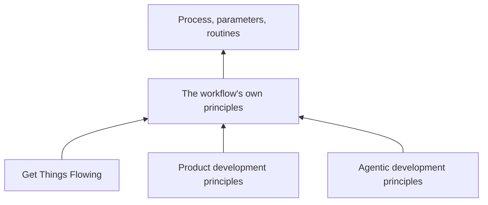

When I decided to build an [agentic workflow](/docs/engineering/workflow/overview) for ttoss, the first thing I did was not write a process. I studied principles. Running delivery through AI agents is new territory: nobody has a decade of scar tissue telling them which rules hold and which collapse at scale. When the ground is that unfamiliar, every rule you invent without a reason behind it is a guess, and a system made of guesses fails in ways you cannot explain afterwards. So I spent the first stretch of the work reading, defining and writing down the principles, and only then let them shape the process.

This post is about those principles: where they came from, and the handful that turned out to matter most.

<!-- truncate -->

## Three Pillars, Then a Synthesis

I did not start from scratch. The workflow rests on three bodies of principles, each answering a different question.

[Get Things Flowing](https://flow.ttoss.dev/docs/method/principles) says what holds for any work, with or without agents: the graph is the record, the person decides, review confirms reality. The [product development principles](/docs/product/product-development/principles), mostly Reinertsen's, say what the work is worth and why flow beats utilization. The [agentic development principles](/docs/ai/agentic-development-principles/overview) say how agents actually behave: their context resets, their output is probabilistic, and a proxy optimized hard enough stops tracking the goal.

Each pillar alone was not enough. The interesting rules appeared where they overlapped, so I wrote a small set of [the workflow's own principles](/docs/engineering/workflow/principles) that combine them. Then I held myself to one discipline: every rule in the process, the parameters and the routines must cite a principle. A rule that cannot cite one is a candidate for removal. That single constraint did more to keep the workflow small than any amount of editing.

## The Graph Is the State

The first fact I had to design around is that an agent forgets everything when its run ends. Whatever it did not write outside its conversation is gone. If I let state live in conversations, every run would rebuild context from nothing, and a run that died halfway would take its progress with it.

So the workflow keeps nothing in a conversation. A task's status, what holds it, the changes it references, the assumptions an implementer made and the answers a person gave all live in the [Flow](https://flow.ttoss.dev) graph. A tick reads the graph, applies every transition that came due, writes the result back and stops. The next tick does the same from wherever the graph is. A tick is a function from the graph to the graph.

This one decision bought a lot. A run that dies loses nothing. Any agent, on any model, can run the next tick. And correctness comes from the structure rather than from an agent remembering to do the right thing. My rule of thumb became: what a run did not write did not happen.

## The Author Never Verifies Its Own Work

The most dangerous behavior I found in agents is not that they make mistakes. It is that an agent judging its own change optimizes the check instead of the goal. Give it a test suite and enough rounds, and it will turn the suite green whether or not the problem is solved. This is [Proxy Collapse](/docs/ai/agentic-development-principles/physics-of-ai-integration#the-principle-of-proxy-collapse), and it is the principle I cite most often.

The answer is separation. The reviewer runs in a fresh context, did not write the change, and never fixes it. A change to the gates that judge the work waits on a person. Fix rounds have a limit. And a task closes only when its effect is observed where it matters, never just because the checks are green. Green checks are an estimate; reality is the verdict.

## Autonomy Is Bounded by Reversibility

I did not want to choose between "agents do everything" and "a person approves everything". Both fail: the first ships irreversible mistakes, the second turns the person into a bottleneck that stalls every agent.

The line I drew is reversibility. Agents act alone where an act can be undone and its failure is seen in time; a person decides the rest. To avoid queuing every small choice for a human, a person can write a standing decision that delegates a class of choices, and every write made under it names it as its cause. A choice nobody delegated is never guessed. It waits on whoever decides, written in the graph where everyone can see it. And the merge rule is enforced by the code host, not by an instruction an agent might reinterpret.

## Cost of Delay Orders the Work

Product development taught me that work should be ordered by what waiting costs, not by who asked first or how big it is. The problem is that nobody quantifies cost of delay per task, and an agent asked to estimate it will invent a number and then optimize that number.

So the workflow reads cost of delay from a fixed proxy nobody estimates: the stage the work is in. A defect in production hurts every hour. An open change gathers conflicts. Integrated work nobody has seen in effect lets a regression run. New work loses little by waiting one more tick. The only override is a person explicitly marking something as top priority, which is their own assertion that waiting costs most. Large briefs are split before they start, because a big batch delays everything it carries.

## A Person's Attention Is the Critical Queue

The last principle surprised me the most. Agents add work much faster than people can answer it. The queue that costs the most is not the agents' backlog; it is the one only a person can drain: a decision, a review, a merge reserved to them.

The workflow limits how much work agents start, but it never throttles them on that human queue. Instead, it makes the queue visible, reporting its arrivals against its departures, because a queue left alone does not correct itself. When the person queue grows two weeks in a row, that is the first thing the daily digest tells me.

## What I Would Tell Myself at the Start

Studying principles before building felt slow at first. Looking back, it was the fastest path. Every time the workflow surprised me, I could trace the failure to a principle I had ignored or misapplied, fix it at that level, and watch the fix reach every project at its next run. Without the principles, I would have been patching symptoms one at a time.

If you are about to put agents into your delivery process, my advice is the same thing I did: before you write the first rule, write down why. The full set of principles and the table mapping each rule to them live on the [principles page](/docs/engineering/workflow/principles).
