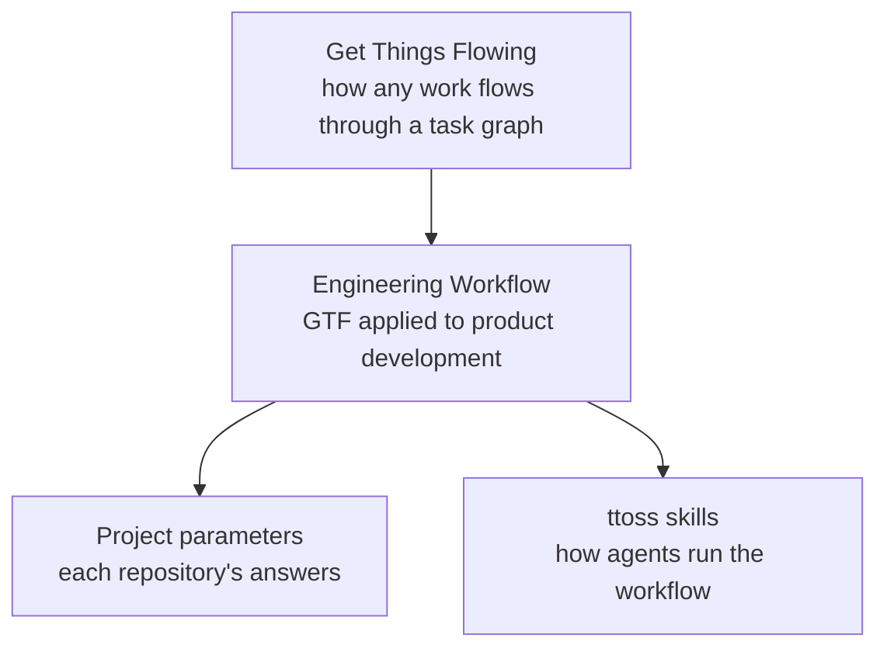
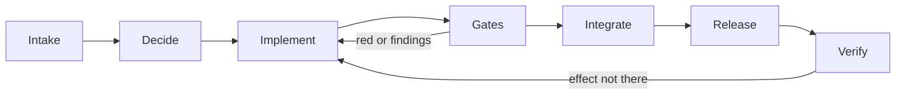

# Engineering Workflow

The engineering workflow is how a change at ttoss goes from a signal to an effect observed in production. It is [Get Things Flowing](https://flow.ttoss.dev/docs/method/principles) (GTF), the general method for working a task graph, applied to product development: the work lives as tasks in [Flow](https://flow.ttoss.dev), every rule cites GTF by its ids, and what this workflow adds is what is true of software delivery in particular — the stages a change passes through, who owns each one, and the questions every project must answer.

Each rule has one home. A rule true of any work belongs in GTF; one true of software delivery belongs here; how an agent carries it out belongs in the [ttoss skills](https://github.com/ttoss/skills); and what is true of a single product is that project's [parameters](./parameters.md). The skills carry the [Delivery Process](./process.md) and the [Project Parameters](./parameters.md) verbatim, so a change to these pages reaches every agent with the next skills release.

## How Work Flows

The [Delivery Process](./process.md) has seven stages, each with one owner, and the transitions between them. A loop runs it: on every tick, a manager agent reads the graph, integrates the changes whose gates passed, runs the release steps and checks that came due, and starts a child agent for each ready task, up to a cap. A person owns every decision the project reserves; agents act only under the project's standing decision in Flow, which delegates the acts the process names ([GTF-T1](https://flow.ttoss.dev/docs/agents/protocol#pursue-a-target)).

## Why It Is Shaped This Way

The loop finishes work before starting more — verify, then release, then gates, then new work — and caps its children, because work in process drives cycle time ([W1](/docs/product/product-development/principles#w1-the-principle-of-wip-constraints-constrain-wip-to-control-cycle-time-and-flow)). A task that holds more than one delivery is split before a child starts it, since small batches cut cycle time and speed feedback ([B1](/docs/product/product-development/principles#b1-the-batch-size-queueing-principle-reducing-batch-size-reduces-cycle-time), [B3](/docs/product/product-development/principles#b3-the-batch-size-feedback-principle-reducing-batch-sizes-accelerates-feedback)). The standing decision is a decision rule that lets agents act without asking each time ([E13](/docs/product/product-development/principles#e13-the-first-decision-rule-principle-use-decision-rules-to-decentralize-economic-control)), and a change that keeps failing for the same reason goes to a person after a set number of rounds, a relief valve decided in advance ([FF15](/docs/product/product-development/principles#ff15-the-relief-valve-principle-have-a-clear-predetermined-relief-valve)). A task closes only when its effect is observed where it matters, because a merge is not feedback ([FF8](/docs/product/product-development/principles#ff8-the-fast-learning-principle-use-fast-feedback-to-make-learning-faster-and-more-efficient)). The gates are [deterministic guardrails](/docs/ai/agentic-engineering-foundations/deterministic-guardrails), and every agent run is recorded in Flow with what it cost, which keeps the loop [observable](/docs/ai/agentic-engineering-foundations/observability).

## Adopting It

A repository adopts the workflow with the [`flow-setup`](https://github.com/ttoss/skills/blob/main/skills/flow-setup/SKILL.md) skill: it installs the skills, defines the [parameters](./parameters.md) with you from what the repository already says, proposes the Flow project and its standing decision, and opens a pull request for your review. The [`flow`](https://github.com/ttoss/skills/blob/main/skills/flow/SKILL.md) skill then runs the loop on whatever schedule fires it.
