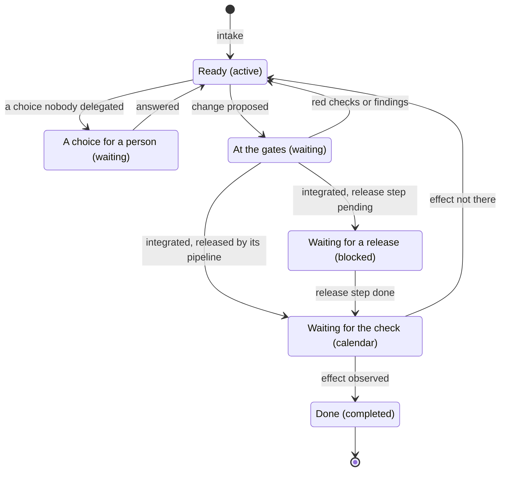
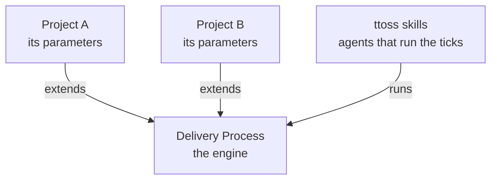

# Agentic Workflow

The agentic workflow is how a change at ttoss goes from a signal to an effect observed in production. Three ideas shape it: it is a state machine over a task graph, one engine runs it for every project while each project extends it, and it is built on [Get Things Flowing](https://flow.ttoss.dev/docs/method/principles) (GTF) and [Flow](https://flow.ttoss.dev).

## A State Machine

A task's state lives in Flow: its status, what holds it, and the changes it references. A tick reads that state, applies the transitions it calls for, writes the new state back, and stops. The next tick reads the state as it is now and does the same. Nothing passes from one tick to the next except the graph, so a tick that dies loses nothing, any agent can run the next one, and whatever schedules the ticks sets the pace. That schedule is the project's [routines](./routines.md): the tick, and beside it a run that chases the people the graph waits on and one that audits what the agents spend.

The [Delivery Process](./process.md) defines every state, the seven stages that move a task between them with one owner each, and the [transitions](./process.md#transitions) a tick applies. The tick applies them in order every time it runs: it verifies what came due, runs the release steps, reviews and integrates the changes whose checks passed, and only then starts a child agent for each ready task, up to a cap.

## One Engine, Extended per Project

The engine is the same for every project: the states, the stages and their owners, the transitions and the rules of the Delivery Process. A project extends it at defined [extension points](./parameters.md#extension-points), its parameters. An extension answers a question the engine asks and never changes the engine. A point left empty takes its default, so a project starts from the engine as it is and extends only where it differs, and a rule that turns out true of every project moves into the engine.

## Built on GTF and Flow

A rule true of any work belongs in GTF; one true of software delivery belongs here; how an agent carries it out belongs in the [ttoss skills](https://github.com/ttoss/skills); and what is true of a single product is that project's [parameters](./parameters.md). The skills read the Delivery Process, the Project Parameters and the Routines from this repository's default branch, so a change to these pages reaches every agent at its next run.

## What It Rests On

Every rule of the workflow applies a [product development](/docs/product/product-development/principles) or [agentic development](/docs/ai/agentic-development-principles/overview) principle, through the workflow's own: the graph is the only memory, the graph is a state machine, one engine extends to any project, the author never verifies its own work, and autonomy is bounded by reversibility. [Principles](./principles.md) states each one and maps every rule to the principles behind it.

## Adopting It

A repository adopts the workflow with the [`flow-setup`](https://github.com/ttoss/skills/blob/main/skills/flow-setup/SKILL.md) skill: it installs the skills, defines the [parameters](./parameters.md) with you from what the repository already says, proposes the Flow project and its standing decision, opens a pull request for your review and, once you integrate it, creates the project's [routines](./routines.md). The [`flow`](https://github.com/ttoss/skills/blob/main/skills/flow/SKILL.md) skill runs the tick and the chase they fire, and [`token-audit`](https://github.com/ttoss/skills/blob/main/skills/token-audit/SKILL.md) the audit.
