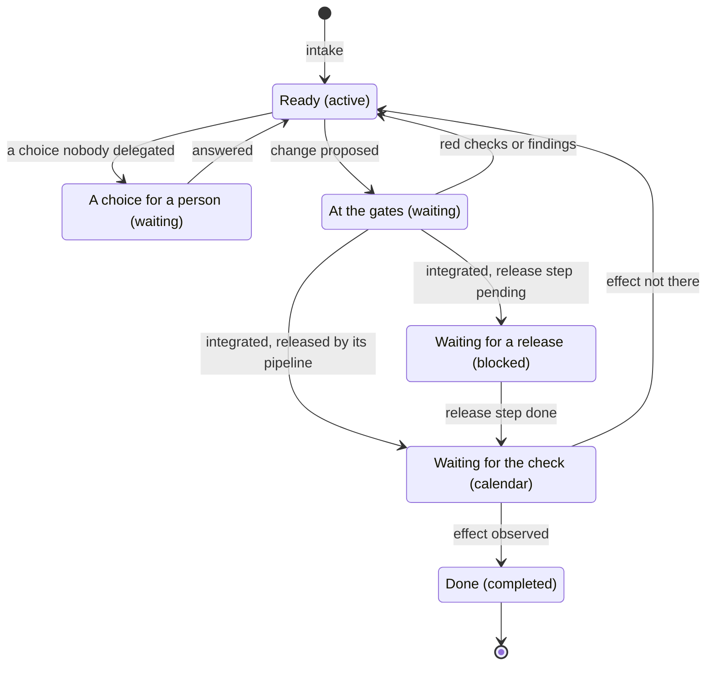
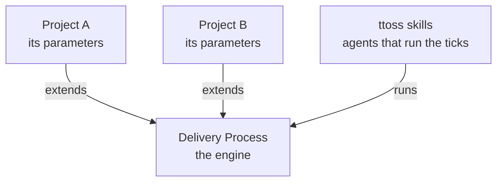

# Engineering Workflow

The engineering workflow is how a change at ttoss goes from a signal to an effect observed in production. Three ideas shape it: it is a state machine over a task graph, one engine runs it for every project while each project extends it, and it is built on [Get Things Flowing](https://flow.ttoss.dev/docs/method/principles) (GTF) and [Flow](https://flow.ttoss.dev).

## A State Machine

A task's state lives in Flow: its status, what holds it, and the changes it references. A tick reads that state, applies the transitions it calls for, writes the new state back, and stops. The next tick reads the state as it is now and does the same. Nothing passes from one tick to the next except the graph, so a tick that dies loses nothing, any agent can run the next one, and whatever schedules the ticks sets the pace. That schedule is the project's [routines](./routines.md): the tick, and beside it a run that chases the people the graph waits on and one that audits what the loop spends.

The [Delivery Process](./process.md) defines every state, the seven stages that move a task between them with one owner each, and the [transitions](./process.md#transitions) a tick applies. A manager agent applies them in order on every tick: it verifies what came due, runs the release steps, reviews and integrates the changes whose checks passed, and only then starts a child agent for each ready task, up to a cap.

## One Engine, Extended per Project

The engine is the same for every project: the states, the stages and their owners, the transitions and the rules of the Delivery Process. A project extends it at defined [extension points](./parameters.md#extension-points), its parameters: where work comes from, what a task must state before an agent starts it, which choices stay with a person, what runs before a change is proposed, who reviews it, when it may be integrated, how it is released, what proves it done, which deliveries are not pull requests, how its agents run and which routines fire them. An extension answers a question the engine asks and never changes the engine. A point left empty takes its default, so a project starts from the engine as it is and extends only where it differs, and a rule that turns out true of every project moves into the engine.

## Built on GTF and Flow

GTF is the general method for working a task graph: who may change a commitment, what every change cites as its cause, how an agent run takes a task, what closes one. Flow holds the graph, records every agent run with what it cost, and refuses the few moves that contradict themselves. The workflow applies both to product development: its state is Flow's task state, and every rule cites GTF by its id instead of restating it. A rule true of any work belongs in GTF; one true of software delivery belongs here; how an agent carries it out belongs in the [ttoss skills](https://github.com/ttoss/skills); and what is true of a single product is that project's [parameters](./parameters.md). The skills carry the Delivery Process and the Project Parameters verbatim, so a change to these pages reaches every agent with the next skills release.

## Why It Is Shaped This Way

Finishing before starting and capping the children keep work in process low, which drives cycle time ([W1](/docs/product/product-development/principles#w1-the-principle-of-wip-constraints-constrain-wip-to-control-cycle-time-and-flow)). A task that holds more than one delivery is split before a child starts it, since small batches cut cycle time and speed feedback ([B1](/docs/product/product-development/principles#b1-the-batch-size-queueing-principle-reducing-batch-size-reduces-cycle-time), [B3](/docs/product/product-development/principles#b3-the-batch-size-feedback-principle-reducing-batch-sizes-accelerates-feedback)). The standing decision is a decision rule that lets agents act without asking each time ([E13](/docs/product/product-development/principles#e13-the-first-decision-rule-principle-use-decision-rules-to-decentralize-economic-control)), and a change that keeps failing for the same reason goes to a person after a set number of rounds, a relief valve decided in advance ([FF15](/docs/product/product-development/principles#ff15-the-relief-valve-principle-have-a-clear-predetermined-relief-valve)). A task closes only when its effect is observed where it matters, because a merge is not feedback ([FF8](/docs/product/product-development/principles#ff8-the-fast-learning-principle-use-fast-feedback-to-make-learning-faster-and-more-efficient)). The gates are [deterministic guardrails](/docs/ai/agentic-engineering-foundations/deterministic-guardrails), and the run records keep the loop [observable](/docs/ai/agentic-engineering-foundations/observability).

## Adopting It

A repository adopts the workflow with the [`flow-setup`](https://github.com/ttoss/skills/blob/main/skills/flow-setup/SKILL.md) skill: it installs the skills, defines the [parameters](./parameters.md) with you from what the repository already says, proposes the Flow project and its standing decision, opens a pull request for your review and, once you integrate it, creates the project's [routines](./routines.md). The [`flow`](https://github.com/ttoss/skills/blob/main/skills/flow/SKILL.md) skill runs the tick and the chase they fire, and [`token-audit`](https://github.com/ttoss/skills/blob/main/skills/token-audit/SKILL.md) the audit.
