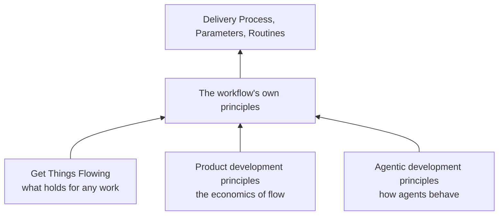

# Principles

The agentic workflow rests on three pillars. [Get Things Flowing](https://flow.ttoss.dev/docs/method/principles) (GTF) says what holds for any work: the graph is the record, the person decides, review confirms reality. The [product development principles](/docs/product/product-development/principles) say what the work is worth and why flow beats utilization. The [agentic development principles](/docs/ai/agentic-development-principles/overview) say how AI agents behave: context resets, output is probabilistic, and a proxy optimized hard enough stops tracking the goal. The workflow's own principles combine the three into a design where a rule needs more than one of them. Every rule of the [Delivery Process](./process.md), the [parameters](./parameters.md) and the [routines](./routines.md) cites a workflow principle where one reaches it, else a pillar directly, as the [table below](#how-each-rule-applies-them) shows.

## The Workflow's Own Principles

### The graph is the state, and a tick is a function of it

An agent's context ends with its run, so whatever a run does not write outside its conversation is lost ([Compounding Context](/docs/ai/agentic-development-principles/architecture-of-flow#the-principle-of-compounding-context)). The workflow therefore keeps nothing in a conversation: a task's status, what holds it, the changes it references, the assumptions an implementer made and the choices a person answered all live in the [Flow](https://flow.ttoss.dev) graph ([P1](https://flow.ttoss.dev/docs/method/principles#p1-one-source-of-truth-outside-every-head)). That state is a machine's: each [transition](./process.md#transitions) is a condition read from it and an act with one owner, so a tick is a function from the graph to the graph ([P5](https://flow.ttoss.dev/docs/method/principles#p5-what-to-do-next-is-computed-not-remembered)). It reads, applies every transition that came due, writes and stops, and the next tick does the same from wherever the graph is. A run that dies loses nothing, any agent on any model can run the next one, and context compounds instead of being rebuilt by every run ([Artifact Persistence](/docs/ai/agentic-development-principles/architecture-of-flow#the-corollary-of-artifact-persistence), [Atomic State Isolation](/docs/ai/agentic-development-principles/physics-of-ai-integration#the-corollary-of-atomic-state-isolation)). Correctness comes from the structure, not from an agent remembering to do the right thing ([Structural Determinism](/docs/ai/agentic-development-principles/physics-of-ai-integration#the-principle-of-structural-determinism)): only a stage's owner moves a task in that stage and, after the verdict, the tick is the only writer ([one owner per transition](./process.md#three-rules), [D9](/docs/product/product-development/principles/achieving-decentralized-control#d9-the-principle-of-boundaries-establish-clear-roles-and-boundaries)), because two writers act on a state the other already changed. The pace belongs to whatever schedules the ticks, not to the agents, and what a run did not write did not happen.

### One engine, extended for any project

The states, stages, owners and transitions are the same for every project. A project extends them only at defined [extension points](./parameters.md#extension-points): an extension answers a question the engine asks and never changes the engine, and a point left empty takes its default. Shared handoffs keep the cost of a new project or a new agent flat instead of growing with every pair ([Protocol Standardization](/docs/ai/agentic-development-principles/protocol-of-communication#the-principle-of-protocol-standardization)). A rule lives at the most general level where it holds, [Get Things Flowing](https://flow.ttoss.dev/docs/method/principles) for any work, this workflow for software delivery, the [ttoss skills](https://github.com/ttoss/skills) for how an agent carries it out and the parameters for one product, and a rule found true in every project moves up ([Curated Minimalism](/docs/ai/agentic-development-principles/architecture-of-flow#the-corollary-of-curated-minimalism)). So any project, delivering code or [anything else](./process.md#delivery-kinds), adopts the workflow by answering its parameters, and an improvement to the engine reaches every project at its next run.

### The author never verifies its own work

An agent that judges its own change optimizes the check instead of the goal ([Proxy Collapse](/docs/ai/agentic-development-principles/physics-of-ai-integration#the-principle-of-proxy-collapse)). The reviewer runs in a fresh context, did not write the change and never fixes it; a change to the gates that judge it waits on a person ([Verifier Sovereignty](/docs/ai/agentic-development-principles/physics-of-ai-integration#the-corollary-of-verifier-sovereignty)); fix rounds have a limit; and a task closes only on its effect observed where it matters, never on green checks ([P6](https://flow.ttoss.dev/docs/method/principles#p6-the-record-is-an-estimate-review-confirms-reality), [Intrinsic Verification](/docs/ai/agentic-development-principles/governance-of-technical-debt#the-corollary-of-intrinsic-verification)).

### Autonomy is bounded by reversibility

Agents act alone where an act can be undone and its failure is seen in time; a person decides the rest ([P2](https://flow.ttoss.dev/docs/method/principles#p2-the-person-decides-the-agent-proposes), [Reversibility-Bounded Autonomy](/docs/ai/agentic-development-principles/governance-of-agency#the-corollary-of-reversibility-bounded-autonomy)). A standing decision delegates what agents may do, so the many small choices are made by rule instead of by queueing for a person, and every write made under it names it as its cause ([P4](https://flow.ttoss.dev/docs/method/principles#p4-every-change-to-a-commitment-carries-its-cause), [E13](/docs/product/product-development/principles/economic-view#e13-the-first-decision-rule-principle-use-decision-rules-to-decentralize-economic-control)). A choice nobody delegated waits on who decides, written in the graph rather than guessed ([Silent Interpretation](/docs/ai/agentic-development-principles/physics-of-ai-integration#the-principle-of-silent-interpretation)), and the code host, not an instruction, enforces the merge rule ([Deterministic Enforcement Supremacy](/docs/ai/agentic-development-principles/foundations-of-hybrid-allocation#the-corollary-of-deterministic-enforcement-supremacy)): a gate nobody can show passed has not passed, since merging is the act no later tick undoes ([Asymmetric Risk](/docs/ai/agentic-development-principles/governance-of-agency#the-principle-of-asymmetric-risk)).

### Cost of delay orders the work, read from a proxy nobody estimates

Work is ordered by what waiting costs, never by who asked first or by size ([F16](/docs/product/product-development/principles/controlling-flow-under-uncertainty#f16-the-hdcf-scheduling-principle-when-job-durations-are-homogeneous-do-the-high-cost-of-delay-job-first), [E5](/docs/product/product-development/principles/economic-view#e5-the-inactivity-principle-watch-the-work-product-not-the-worker)). Nobody quantifies that cost per task, and an agent asked to would invent a number and then optimize it ([Silent Interpretation](/docs/ai/agentic-development-principles/physics-of-ai-integration#the-principle-of-silent-interpretation), [Proxy Collapse](/docs/ai/agentic-development-principles/physics-of-ai-integration#the-principle-of-proxy-collapse)), so the workflow reads it from a fixed proxy, the same for every project: the [stage](./process.md#three-rules) the work is in, since a defect in production hurts every hour, an open change gathers conflicts, integrated work nobody has seen in effect lets a regression run, and new work loses little by waiting a tick; and the one word a person may add, a `very_high` priority, which is their own assertion that waiting costs most, whatever the stage ([P2](https://flow.ttoss.dev/docs/method/principles#p2-the-person-decides-the-agent-proposes)). The proxy is the economics, coarsened: the order of the stages is their cost of delay ranked once for every project, which prevents the large mistakes without the per-task precision nobody has ([E1](/docs/product/product-development/principles/economic-view#e1-the-principle-of-quantified-overall-economics-select-actions-based-on-quantified-overall-economic-impact), [FF2](/docs/product/product-development/principles/using-fast-feedback#ff2-the-principle-of-efficient-control-control-parameters-that-are-both-influential-and-efficient)). Below the proxy, Flow's ranking, priority then leverage ([P5](https://flow.ttoss.dev/docs/method/principles#p5-what-to-do-next-is-computed-not-remembered)), orders the work inside a stage and never across them, since a priority holds only where the work is waiting ([F18](/docs/product/product-development/principles/controlling-flow-under-uncertainty#f18-the-local-priority-principle-priorities-are-inherently-local)). A brief asking for several deliveries is split before it is started, because a large batch delays everything it carries ([B1](/docs/product/product-development/principles/reducing-batch-size#b1-the-batch-size-queueing-principle-reducing-batch-size-reduces-cycle-time)), and the Chase reports its sections in the same order, so a person reads first what their delay costs most.

### A person's attention is the critical queue

Agents add work faster than people answer it, so the queue that costs most is the one only a person can drain: a decision, a review, a merge reserved to them ([W21](/docs/product/product-development/principles/applying-wip-constraints#w21-the-principle-of-the-critical-queue-constrain-wip-in-the-section-of-the-system-where-the-queue-is-most-expensive), [FF24](/docs/product/product-development/principles/using-fast-feedback#ff24-the-attention-principle-time-counts-more-than-money)). So the tick holds new work upstream, where waiting is cheap, under two [limits](./parameters.md#runtime): the changes in flight, since a child ends at its handoff and the run cap alone leaves its changes unbounded ([W1](/docs/product/product-development/principles/applying-wip-constraints#w1-the-principle-of-wip-constraints-constrain-wip-to-control-cycle-time-and-flow)), and what waits on the project's people, one queue since their attention is shared ([W21](/docs/product/product-development/principles/applying-wip-constraints#w21-the-principle-of-the-critical-queue-constrain-wip-in-the-section-of-the-system-where-the-queue-is-most-expensive)). New changes start only up to their limit; the people queue slows new work to one task a tick from half its limit, since the work reaches them only later, and stops it at the limit. Only new work waits: integrating, releases, checks, rounds and what a person marked urgent go on, so their answers keep turning into progress. Each limit reads the queue's size, which reacts at once, never its cycle time, which reacts only once the work leaves ([Q13](/docs/product/product-development/principles/managing-queues#q13-the-first-queue-size-control-principle-dont-control-capacity-utilization-control-queue-size), [Q14](/docs/product/product-development/principles/managing-queues#q14-the-second-queue-size-control-principle-dont-control-cycle-time-control-queue-size)), and the Chase shows that queue's arrivals against its departures, because a queue left alone does not correct itself ([Q16](/docs/product/product-development/principles/managing-queues#q16-the-intervention-principle-we-cannot-rely-on-randomness-to-correct-a-random-queue)).

## How Each Rule Applies Them

The pages the agents read cite a principle only where the reason changes what an agent decides; this table carries the rest, for whoever changes a rule. A rule that cannot cite one is a candidate for removal.

| The workflow says                                                                                                 | Because                                                                                                                                                                                                                                                                                                                                                                                                                                                                                                                                                                                                                                                                                                                                                                                                                                                                                                                                                                                                                                                                                                                                                                                                     |
| ----------------------------------------------------------------------------------------------------------------- | ----------------------------------------------------------------------------------------------------------------------------------------------------------------------------------------------------------------------------------------------------------------------------------------------------------------------------------------------------------------------------------------------------------------------------------------------------------------------------------------------------------------------------------------------------------------------------------------------------------------------------------------------------------------------------------------------------------------------------------------------------------------------------------------------------------------------------------------------------------------------------------------------------------------------------------------------------------------------------------------------------------------------------------------------------------------------------------------------------------------------------------------------------------------------------------------------------------- |
| The graph is the state; a tick that dies loses nothing                                                            | [P1](https://flow.ttoss.dev/docs/method/principles#p1-one-source-of-truth-outside-every-head), [P5](https://flow.ttoss.dev/docs/method/principles#p5-what-to-do-next-is-computed-not-remembered), [Compounding Context](/docs/ai/agentic-development-principles/architecture-of-flow#the-principle-of-compounding-context), [Atomic State Isolation](/docs/ai/agentic-development-principles/physics-of-ai-integration#the-corollary-of-atomic-state-isolation)                                                                                                                                                                                                                                                                                                                                                                                                                                                                                                                                                                                                                                                                                                                                             |
| One engine, extended at defined points                                                                            | [Protocol Standardization](/docs/ai/agentic-development-principles/protocol-of-communication#the-principle-of-protocol-standardization)                                                                                                                                                                                                                                                                                                                                                                                                                                                                                                                                                                                                                                                                                                                                                                                                                                                                                                                                                                                                                                                                     |
| A rule lives at the most general level where it holds                                                             | [Curated Minimalism](/docs/ai/agentic-development-principles/architecture-of-flow#the-corollary-of-curated-minimalism)                                                                                                                                                                                                                                                                                                                                                                                                                                                                                                                                                                                                                                                                                                                                                                                                                                                                                                                                                                                                                                                                                      |
| One owner per transition                                                                                          | [D9](/docs/product/product-development/principles/achieving-decentralized-control#d9-the-principle-of-boundaries-establish-clear-roles-and-boundaries)                                                                                                                                                                                                                                                                                                                                                                                                                                                                                                                                                                                                                                                                                                                                                                                                                                                                                                                                                                                                                                                      |
| Rounds have a limit                                                                                               | [Proxy Collapse](/docs/ai/agentic-development-principles/physics-of-ai-integration#the-principle-of-proxy-collapse), [Compounding Contextual Error](/docs/ai/agentic-development-principles/physics-of-ai-integration#the-corollary-of-compounding-contextual-error)                                                                                                                                                                                                                                                                                                                                                                                                                                                                                                                                                                                                                                                                                                                                                                                                                                                                                                                                        |
| What ages fastest goes first, read from the stage and a `very_high` priority                                      | [Silent Interpretation](/docs/ai/agentic-development-principles/physics-of-ai-integration#the-principle-of-silent-interpretation), [Proxy Collapse](/docs/ai/agentic-development-principles/physics-of-ai-integration#the-principle-of-proxy-collapse), [P2](https://flow.ttoss.dev/docs/method/principles#p2-the-person-decides-the-agent-proposes), [E1](/docs/product/product-development/principles/economic-view#e1-the-principle-of-quantified-overall-economics-select-actions-based-on-quantified-overall-economic-impact), [FF2](/docs/product/product-development/principles/using-fast-feedback#ff2-the-principle-of-efficient-control-control-parameters-that-are-both-influential-and-efficient), [F16](/docs/product/product-development/principles/controlling-flow-under-uncertainty#f16-the-hdcf-scheduling-principle-when-job-durations-are-homogeneous-do-the-high-cost-of-delay-job-first), [F18](/docs/product/product-development/principles/controlling-flow-under-uncertainty#f18-the-local-priority-principle-priorities-are-inherently-local), [E5](/docs/product/product-development/principles/economic-view#e5-the-inactivity-principle-watch-the-work-product-not-the-worker) |
| Intake writes a task, never a fix                                                                                 | [P3](https://flow.ttoss.dev/docs/method/principles#p3-capturing-is-not-committing), [Admission Control](/docs/ai/agentic-development-principles/economics-of-interaction#the-corollary-of-admission-control)                                                                                                                                                                                                                                                                                                                                                                                                                                                                                                                                                                                                                                                                                                                                                                                                                                                                                                                                                                                                |
| A choice goes to a person only after a test                                                                       | [P2](https://flow.ttoss.dev/docs/method/principles#p2-the-person-decides-the-agent-proposes), [E10](/docs/product/product-development/principles/economic-view#e10-the-first-perishability-principle-many-economic-choices-are-more-valuable-when-made-quickly), [E13](/docs/product/product-development/principles/economic-view#e13-the-first-decision-rule-principle-use-decision-rules-to-decentralize-economic-control), [Silent Interpretation](/docs/ai/agentic-development-principles/physics-of-ai-integration#the-principle-of-silent-interpretation)                                                                                                                                                                                                                                                                                                                                                                                                                                                                                                                                                                                                                                             |
| A brief asking for several deliveries is split                                                                    | [Problem Decomposition](/docs/ai/agentic-development-principles/physics-of-ai-integration#the-corollary-of-problem-decomposition), [B1](/docs/product/product-development/principles/reducing-batch-size#b1-the-batch-size-queueing-principle-reducing-batch-size-reduces-cycle-time)                                                                                                                                                                                                                                                                                                                                                                                                                                                                                                                                                                                                                                                                                                                                                                                                                                                                                                                       |
| The implementer records its assumptions at the handoff                                                            | [Externalized Confusion](/docs/ai/agentic-development-principles/physics-of-ai-integration#the-corollary-of-externalized-confusion), [Seam Memory Layer](/docs/ai/agentic-development-principles/architecture-of-flow#the-corollary-of-the-seam-memory-layer)                                                                                                                                                                                                                                                                                                                                                                                                                                                                                                                                                                                                                                                                                                                                                                                                                                                                                                                                               |
| The change goes up green, with its reversal path                                                                  | [Verification Latency](/docs/ai/agentic-development-principles/physics-of-ai-integration#the-corollary-of-verification-latency), [Designed Reversal](/docs/ai/agentic-development-principles/economics-of-interaction#the-corollary-of-designed-reversal)                                                                                                                                                                                                                                                                                                                                                                                                                                                                                                                                                                                                                                                                                                                                                                                                                                                                                                                                                   |
| An integration that proves harmful is reverted by that path before the fix                                        | [Designed Reversal](/docs/ai/agentic-development-principles/economics-of-interaction#the-corollary-of-designed-reversal), [Reversibility-Bounded Autonomy](/docs/ai/agentic-development-principles/governance-of-agency#the-corollary-of-reversibility-bounded-autonomy), [F17](/docs/product/product-development/principles/controlling-flow-under-uncertainty#f17-the-wsjf-scheduling-principle-when-job-durations-and-delay-costs-are-not-homogeneous-use-wsjf), [P4](https://flow.ttoss.dev/docs/method/principles#p4-every-change-to-a-commitment-carries-its-cause)                                                                                                                                                                                                                                                                                                                                                                                                                                                                                                                                                                                                                                   |
| The reviewer did not write the change and never fixes it                                                          | [Verifier Sovereignty](/docs/ai/agentic-development-principles/physics-of-ai-integration#the-corollary-of-verifier-sovereignty), [Boundary Justification](/docs/ai/agentic-development-principles/architecture-of-flow#the-corollary-of-boundary-justification)                                                                                                                                                                                                                                                                                                                                                                                                                                                                                                                                                                                                                                                                                                                                                                                                                                                                                                                                             |
| The agents integrate; a change to its own gates waits on a person                                                 | [Reversibility-Bounded Autonomy](/docs/ai/agentic-development-principles/governance-of-agency#the-corollary-of-reversibility-bounded-autonomy), [Verifier Sovereignty](/docs/ai/agentic-development-principles/physics-of-ai-integration#the-corollary-of-verifier-sovereignty)                                                                                                                                                                                                                                                                                                                                                                                                                                                                                                                                                                                                                                                                                                                                                                                                                                                                                                                             |
| A task closes on an effect observed where it matters                                                              | [P6](https://flow.ttoss.dev/docs/method/principles#p6-the-record-is-an-estimate-review-confirms-reality), [Detection Window](/docs/ai/agentic-development-principles/economics-of-interaction#the-corollary-of-the-detection-window), [Intrinsic Verification](/docs/ai/agentic-development-principles/governance-of-technical-debt#the-corollary-of-intrinsic-verification)                                                                                                                                                                                                                                                                                                                                                                                                                                                                                                                                                                                                                                                                                                                                                                                                                                |
| The code host enforces the merge rule; instructions change only through a person's merge                          | [Deterministic Enforcement Supremacy](/docs/ai/agentic-development-principles/foundations-of-hybrid-allocation#the-corollary-of-deterministic-enforcement-supremacy), [Control Stack](/docs/ai/agentic-development-principles/physics-of-ai-integration#the-corollary-of-the-control-stack)                                                                                                                                                                                                                                                                                                                                                                                                                                                                                                                                                                                                                                                                                                                                                                                                                                                                                                                 |
| A gate fails closed: no verdict for the head, or a `Review` the parameters do not state, never reads as passed    | [Asymmetric Risk](/docs/ai/agentic-development-principles/governance-of-agency#the-principle-of-asymmetric-risk), [Reversibility-Bounded Autonomy](/docs/ai/agentic-development-principles/governance-of-agency#the-corollary-of-reversibility-bounded-autonomy), [Silent Interpretation](/docs/ai/agentic-development-principles/physics-of-ai-integration#the-principle-of-silent-interpretation)                                                                                                                                                                                                                                                                                                                                                                                                                                                                                                                                                                                                                                                                                                                                                                                                         |
| A verdict is a status on the commit it judged, from an identity allowed to give it, and the code host requires it | [Deterministic Enforcement Supremacy](/docs/ai/agentic-development-principles/foundations-of-hybrid-allocation#the-corollary-of-deterministic-enforcement-supremacy), [Verifier Sovereignty](/docs/ai/agentic-development-principles/physics-of-ai-integration#the-corollary-of-verifier-sovereignty), [Instruction-Data Conflation](/docs/ai/agentic-development-principles/physics-of-ai-integration#the-principle-of-instruction-data-conflation)                                                                                                                                                                                                                                                                                                                                                                                                                                                                                                                                                                                                                                                                                                                                                        |
| Models by exact id                                                                                                | [Pinned Substrate Migration](/docs/ai/agentic-development-principles/physics-of-ai-integration#the-corollary-of-pinned-substrate-migration)                                                                                                                                                                                                                                                                                                                                                                                                                                                                                                                                                                                                                                                                                                                                                                                                                                                                                                                                                                                                                                                                 |
| Child runs are capped; a stale one is closed                                                                      | [W1](/docs/product/product-development/principles/applying-wip-constraints#w1-the-principle-of-wip-constraints-constrain-wip-to-control-cycle-time-and-flow), [F19](/docs/product/product-development/principles/controlling-flow-under-uncertainty#f19-the-round-robin-principle-when-task-duration-is-unknown-share-time-among-tasks)                                                                                                                                                                                                                                                                                                                                                                                                                                                                                                                                                                                                                                                                                                                                                                                                                                                                     |
| New work waits upstream past the open-changes and people-queue limits; only new work does                         | [W1](/docs/product/product-development/principles/applying-wip-constraints#w1-the-principle-of-wip-constraints-constrain-wip-to-control-cycle-time-and-flow), [W21](/docs/product/product-development/principles/applying-wip-constraints#w21-the-principle-of-the-critical-queue-constrain-wip-in-the-section-of-the-system-where-the-queue-is-most-expensive), [Q13](/docs/product/product-development/principles/managing-queues#q13-the-first-queue-size-control-principle-dont-control-capacity-utilization-control-queue-size), [Q14](/docs/product/product-development/principles/managing-queues#q14-the-second-queue-size-control-principle-dont-control-cycle-time-control-queue-size), [P2](https://flow.ttoss.dev/docs/method/principles#p2-the-person-decides-the-agent-proposes)                                                                                                                                                                                                                                                                                                                                                                                                              |
| Another agent's run holding a task past `Stale after` is left, and reported                                       | [P7](https://flow.ttoss.dev/docs/method/principles#p7-report-dont-refuse-reconcile-explicitly)                                                                                                                                                                                                                                                                                                                                                                                                                                                                                                                                                                                                                                                                                                                                                                                                                                                                                                                                                                                                                                                                                                              |
| Routines run on nested cadences, on the cheapest model that does the work                                         | [F5](/docs/product/product-development/principles/controlling-flow-under-uncertainty#f5-the-principle-of-periodic-resynchronization-use-a-regular-cadence-to-limit-the-accumulation-of-variance), [F14](/docs/product/product-development/principles/controlling-flow-under-uncertainty#f14-the-harmonic-principle-make-nested-cadences-harmonic-multiples), [Allocative Efficiency](/docs/ai/agentic-development-principles/economics-of-interaction#the-principle-of-allocative-efficiency)                                                                                                                                                                                                                                                                                                                                                                                                                                                                                                                                                                                                                                                                                                               |
| The Chase tells people what the graph holds for them                                                              | [Contextual Readiness](/docs/ai/agentic-development-principles/architecture-of-flow#the-corollary-of-contextual-readiness)                                                                                                                                                                                                                                                                                                                                                                                                                                                                                                                                                                                                                                                                                                                                                                                                                                                                                                                                                                                                                                                                                  |
| The Chase reports each state's arrivals, departures and age, computed by Flow                                     | [E5](/docs/product/product-development/principles/economic-view#e5-the-inactivity-principle-watch-the-work-product-not-the-worker), [Q11](/docs/product/product-development/principles/managing-queues#q11-the-cumulative-flow-principle-use-cfds-to-monitor-queues)                                                                                                                                                                                                                                                                                                                                                                                                                                                                                                                                                                                                                                                                                                                                                                                                                                                                                                                                        |
| The person queue comes first, and growing two weeks running opens the digest                                      | [W21](/docs/product/product-development/principles/applying-wip-constraints#w21-the-principle-of-the-critical-queue-constrain-wip-in-the-section-of-the-system-where-the-queue-is-most-expensive), [Q13](/docs/product/product-development/principles/managing-queues#q13-the-first-queue-size-control-principle-dont-control-capacity-utilization-control-queue-size), [Q16](/docs/product/product-development/principles/managing-queues#q16-the-intervention-principle-we-cannot-rely-on-randomness-to-correct-a-random-queue), [FF24](/docs/product/product-development/principles/using-fast-feedback#ff24-the-attention-principle-time-counts-more-than-money)                                                                                                                                                                                                                                                                                                                                                                                                                                                                                                                                        |
| The Chase reports rework after the check, and failure demand                                                      | [FF3](/docs/product/product-development/principles/using-fast-feedback#ff3-the-principle-of-leading-indicators-select-control-variables-that-predict-future-system-behavior), [Proxy Collapse](/docs/ai/agentic-development-principles/physics-of-ai-integration#the-principle-of-proxy-collapse)                                                                                                                                                                                                                                                                                                                                                                                                                                                                                                                                                                                                                                                                                                                                                                                                                                                                                                           |
| Health numbers are written as Flow answers them: no ratio, no goal, no threshold                                  | [Proxy Collapse](/docs/ai/agentic-development-principles/physics-of-ai-integration#the-principle-of-proxy-collapse)                                                                                                                                                                                                                                                                                                                                                                                                                                                                                                                                                                                                                                                                                                                                                                                                                                                                                                                                                                                                                                                                                         |
| The routines' arithmetic is computed by scripts from Flow's answers, never by an agent                            | [Problem Structure Allocation](/docs/ai/agentic-development-principles/foundations-of-hybrid-allocation#the-principle-of-problem-structure-allocation), [Structural Determinism](/docs/ai/agentic-development-principles/physics-of-ai-integration#the-principle-of-structural-determinism)                                                                                                                                                                                                                                                                                                                                                                                                                                                                                                                                                                                                                                                                                                                                                                                                                                                                                                                 |
| The Audit measures what runs spend                                                                                | [Prompt Economics](/docs/ai/agentic-development-principles/economics-of-interaction#the-principle-of-prompt-economics)                                                                                                                                                                                                                                                                                                                                                                                                                                                                                                                                                                                                                                                                                                                                                                                                                                                                                                                                                                                                                                                                                      |
| The Audit reads spend on work that did not ship, incubated exits and the inbox                                    | [E1](/docs/product/product-development/principles/economic-view#e1-the-principle-of-quantified-overall-economics-select-actions-based-on-quantified-overall-economic-impact), [Q1](/docs/product/product-development/principles/managing-queues#q1-the-principle-of-invisible-inventory-product-development-inventory-is-physically-and-financially-invisible), [W20](/docs/product/product-development/principles/applying-wip-constraints#w20-the-expansion-control-principle-prevent-uncontrolled-expansion-of-work)                                                                                                                                                                                                                                                                                                                                                                                                                                                                                                                                                                                                                                                                                     |
| The Audit proposes a standing rule from an answer a person gave more than once                                    | [P4](https://flow.ttoss.dev/docs/method/principles#p4-every-change-to-a-commitment-carries-its-cause), [P2](https://flow.ttoss.dev/docs/method/principles#p2-the-person-decides-the-agent-proposes), [E13](/docs/product/product-development/principles/economic-view#e13-the-first-decision-rule-principle-use-decision-rules-to-decentralize-economic-control), [W21](/docs/product/product-development/principles/applying-wip-constraints#w21-the-principle-of-the-critical-queue-constrain-wip-in-the-section-of-the-system-where-the-queue-is-most-expensive)                                                                                                                                                                                                                                                                                                                                                                                                                                                                                                                                                                                                                                         |
