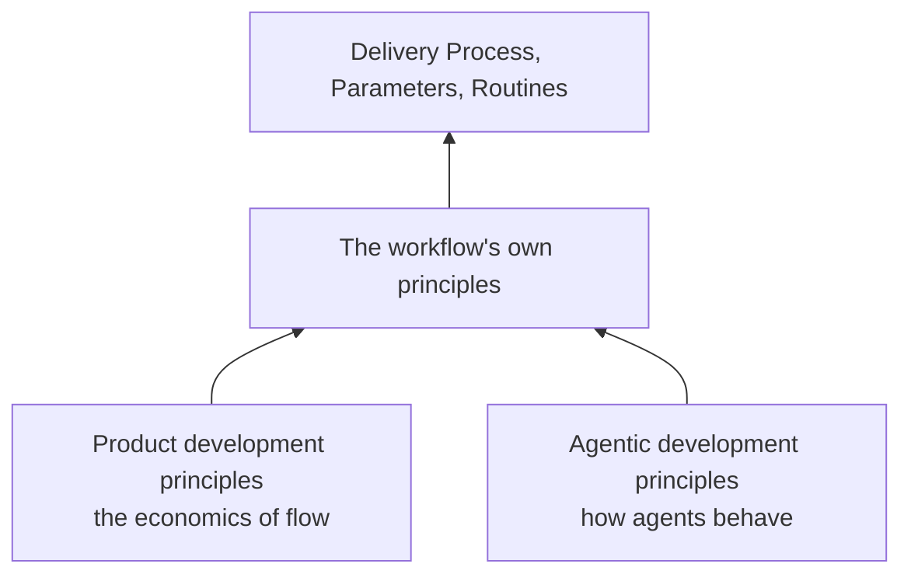

# Principles

The agentic workflow rests on three pillars. The [product development principles](/docs/product/product-development/principles) say what the work is worth and why flow beats utilization. The [agentic development principles](/docs/ai/agentic-development-principles/overview) say how AI agents behave: context resets, output is probabilistic, and a proxy optimized hard enough stops tracking the goal. The workflow's own principles combine the two into a design. Every rule of the [Delivery Process](./process.md), the [parameters](./parameters.md) and the [routines](./routines.md) applies one of them, and a rule that cannot cite one is a candidate for removal.

## The Workflow's Own Principles

### The graph is the only memory

An agent's context ends with its run, so whatever a run does not write outside its conversation is lost ([Compounding Context](/docs/ai/agentic-development-principles/architecture-of-flow#the-principle-of-compounding-context)). The workflow therefore keeps nothing in a conversation: a task's state, what holds it, the changes it references, the assumptions an implementer made and the choices a person answered all live in the [Flow](https://flow.ttoss.dev) graph. A run reads the graph, acts, writes the result and stops. A run that dies loses nothing, any agent on any model can run the next one, and context compounds instead of being rebuilt by every run ([Artifact Persistence](/docs/ai/agentic-development-principles/architecture-of-flow#the-corollary-of-artifact-persistence), [Atomic State Isolation](/docs/ai/agentic-development-principles/physics-of-ai-integration#the-corollary-of-atomic-state-isolation)). What a run did not write did not happen.

### The graph is a state machine

A task's state is its status, what holds it and the changes it references. Each [transition](./process.md#transitions) is a condition read from that state and an act with one owner, so a tick is a function from the graph to the graph: it reads, applies every transition that came due, writes and stops, and the next tick does the same from wherever the graph is. Correctness comes from the structure, not from an agent remembering to do the right thing ([Structural Determinism](/docs/ai/agentic-development-principles/physics-of-ai-integration#the-principle-of-structural-determinism)). This is why only a stage's owner moves a task in that stage and why, after the verdict, the tick is the only writer ([one owner per transition](./process.md#three-rules), [D9](/docs/product/product-development/principles#d9-the-principle-of-boundaries-establish-clear-roles-and-boundaries)): two writers act on a state the other already changed. It is also why the pace belongs to whatever schedules the ticks, not to the agents.

### One engine, extended for any project

The states, stages, owners and transitions are the same for every project. A project extends them only at defined [extension points](./parameters.md#extension-points): an extension answers a question the engine asks and never changes the engine, and a point left empty takes its default. Shared handoffs keep the cost of a new project or a new agent flat instead of growing with every pair ([Protocol Standardization](/docs/ai/agentic-development-principles/protocol-of-communication#the-principle-of-protocol-standardization)). A rule lives at the most general level where it holds, [Get Things Flowing](https://flow.ttoss.dev/docs/method/principles) for any work, this workflow for software delivery, the [ttoss skills](https://github.com/ttoss/skills) for how an agent carries it out and the parameters for one product, and a rule found true in every project moves up ([Curated Minimalism](/docs/ai/agentic-development-principles/architecture-of-flow#the-corollary-of-curated-minimalism)). So any project, delivering code or [anything else](./process.md#delivery-kinds), adopts the workflow by answering its parameters, and an improvement to the engine reaches every project at its next run.

### The author never verifies its own work

An agent that judges its own change optimizes the check instead of the goal ([Proxy Collapse](/docs/ai/agentic-development-principles/physics-of-ai-integration#the-principle-of-proxy-collapse)). The reviewer runs in a fresh context, did not write the change and never fixes it; a change to the gates that judge it waits on a person ([Verifier Sovereignty](/docs/ai/agentic-development-principles/physics-of-ai-integration#the-corollary-of-verifier-sovereignty)); fix rounds have a limit; and a task closes only on its effect observed where it matters, never on green checks ([Intrinsic Verification](/docs/ai/agentic-development-principles/governance-of-technical-debt#the-corollary-of-intrinsic-verification), [FF3](/docs/product/product-development/principles#ff3-the-principle-of-leading-indicators-select-control-variables-that-predict-future-system-behavior)).

### Autonomy is bounded by reversibility

Agents act alone where an act can be undone and its failure is seen in time; a person decides the rest ([Reversibility-Bounded Autonomy](/docs/ai/agentic-development-principles/governance-of-agency#the-corollary-of-reversibility-bounded-autonomy)). A standing decision delegates what agents may do, so the many small choices are made by rule instead of by queueing for a person ([E13](/docs/product/product-development/principles#e13-the-first-decision-rule-principle-use-decision-rules-to-decentralize-economic-control)). A choice nobody delegated waits on who decides, written in the graph rather than guessed ([Silent Interpretation](/docs/ai/agentic-development-principles/physics-of-ai-integration#the-principle-of-silent-interpretation)), and the code host, not an instruction, enforces the merge rule ([Deterministic Enforcement Supremacy](/docs/ai/agentic-development-principles/foundations-of-hybrid-allocation#the-corollary-of-deterministic-enforcement-supremacy)).

## Product Development Principles

The workflow treats delivery as an economic flow, not a utilization problem. What it takes from each chapter:

| Chapter                                                                                                               | What the workflow takes from it                                                                                                                                                                                                                                                                                                                                                                                                                                                                                                                                                                                                                                                                    |
| --------------------------------------------------------------------------------------------------------------------- | -------------------------------------------------------------------------------------------------------------------------------------------------------------------------------------------------------------------------------------------------------------------------------------------------------------------------------------------------------------------------------------------------------------------------------------------------------------------------------------------------------------------------------------------------------------------------------------------------------------------------------------------------------------------------------------------------- |
| [The Economic View](/docs/product/product-development/principles#the-economic-view)                                   | Work is ordered by cost of delay ([E3](/docs/product/product-development/principles#e3-the-principle-of-quantified-cost-of-delay-if-you-only-quantify-one-thing-quantify-the-cost-of-delay)), read from the stage the work is in ([E5](/docs/product/product-development/principles#e5-the-inactivity-principle-watch-the-work-product-not-the-worker)); decisions are made fast ([E10](/docs/product/product-development/principles#e10-the-first-perishability-principle-many-economic-choices-are-more-valuable-when-made-quickly)) and by rule ([E13](/docs/product/product-development/principles#e13-the-first-decision-rule-principle-use-decision-rules-to-decentralize-economic-control)) |
| [Managing Queues](/docs/product/product-development/principles#managing-queues)                                       | Work waiting on a person is invisible inventory ([Q1](/docs/product/product-development/principles#q1-the-principle-of-invisible-inventory-product-development-inventory-is-physically-and-financially-invisible)), so every wait is written in the graph and the Chase shows it                                                                                                                                                                                                                                                                                                                                                                                                                   |
| [Reducing Batch Size](/docs/product/product-development/principles#reducing-batch-size)                               | A brief asking for several deliveries is split ([B1](/docs/product/product-development/principles#b1-the-batch-size-queueing-principle-reducing-batch-size-reduces-cycle-time))                                                                                                                                                                                                                                                                                                                                                                                                                                                                                                                    |
| [Applying WIP Constraints](/docs/product/product-development/principles#applying-wip-constraints)                     | Child runs are capped ([W1](/docs/product/product-development/principles#w1-the-principle-of-wip-constraints-constrain-wip-to-control-cycle-time-and-flow))                                                                                                                                                                                                                                                                                                                                                                                                                                                                                                                                        |
| [Controlling Flow Under Uncertainty](/docs/product/product-development/principles#controlling-flow-under-uncertainty) | Ticks run on a regular, nested cadence ([F5](/docs/product/product-development/principles#f5-the-principle-of-periodic-resynchronization-use-a-regular-cadence-to-limit-the-accumulation-of-variance), [F14](/docs/product/product-development/principles#f14-the-harmonic-principle-make-nested-cadences-harmonic-multiples)); what ages fastest goes first ([F17](/docs/product/product-development/principles#f17-the-wsjf-scheduling-principle-when-job-durations-and-delay-costs-are-not-homogeneous-use-wsjf)); a stale run is closed ([F19](/docs/product/product-development/principles#f19-the-round-robin-principle-when-task-duration-is-unknown-share-time-among-tasks))               |
| [Using Fast Feedback](/docs/product/product-development/principles#using-fast-feedback)                               | A task closes on an effect that predicts the outcome, observed in production ([FF3](/docs/product/product-development/principles#ff3-the-principle-of-leading-indicators-select-control-variables-that-predict-future-system-behavior))                                                                                                                                                                                                                                                                                                                                                                                                                                                            |
| [Achieving Decentralized Control](/docs/product/product-development/principles#achieving-decentralized-control)       | One owner per stage, with clear boundaries ([D9](/docs/product/product-development/principles#d9-the-principle-of-boundaries-establish-clear-roles-and-boundaries))                                                                                                                                                                                                                                                                                                                                                                                                                                                                                                                                |

## Agentic Development Principles

The workflow treats agents as probabilistic workers with no memory between runs. What it takes from each chapter:

| Chapter                                                                                                      | What the workflow takes from it                                                                                                                                                                                                                                                                                                                                                                                                                                                                                           |
| ------------------------------------------------------------------------------------------------------------ | ------------------------------------------------------------------------------------------------------------------------------------------------------------------------------------------------------------------------------------------------------------------------------------------------------------------------------------------------------------------------------------------------------------------------------------------------------------------------------------------------------------------------- |
| [Physics of AI Integration](/docs/ai/agentic-development-principles/physics-of-ai-integration)               | Correctness by structure, not instruction; a fresh verifier; limited rounds; pinned models ([Pinned Substrate Migration](/docs/ai/agentic-development-principles/physics-of-ai-integration#the-corollary-of-pinned-substrate-migration))                                                                                                                                                                                                                                                                                  |
| [Architecture of Flow](/docs/ai/agentic-development-principles/architecture-of-flow)                         | The graph as shared memory; a separate agent only where isolation pays ([Boundary Justification](/docs/ai/agentic-development-principles/architecture-of-flow#the-corollary-of-boundary-justification))                                                                                                                                                                                                                                                                                                                   |
| [Protocol of Communication](/docs/ai/agentic-development-principles/protocol-of-communication)               | One engine and one vocabulary for every handoff                                                                                                                                                                                                                                                                                                                                                                                                                                                                           |
| [Economics of Interaction](/docs/ai/agentic-development-principles/economics-of-interaction)                 | Intake writes a task, never a fix ([Admission Control](/docs/ai/agentic-development-principles/economics-of-interaction#the-corollary-of-admission-control)); every change carries its reversal path ([Designed Reversal](/docs/ai/agentic-development-principles/economics-of-interaction#the-corollary-of-designed-reversal)); routines run on the cheapest model that does the work ([Allocative Efficiency](/docs/ai/agentic-development-principles/economics-of-interaction#the-principle-of-allocative-efficiency)) |
| [Governance of Agency](/docs/ai/agentic-development-principles/governance-of-agency)                         | Autonomy bounded by reversibility                                                                                                                                                                                                                                                                                                                                                                                                                                                                                         |
| [Governance of Technical Debt](/docs/ai/agentic-development-principles/governance-of-technical-debt)         | Verification of the effect, not of the proxy                                                                                                                                                                                                                                                                                                                                                                                                                                                                              |
| [Foundations of Hybrid Allocation](/docs/ai/agentic-development-principles/foundations-of-hybrid-allocation) | The code host enforces what instructions only ask                                                                                                                                                                                                                                                                                                                                                                                                                                                                         |
| [Symbiosis of Human-AI Agency](/docs/ai/agentic-development-principles/symbiosis-of-human-ai-agency)         | A person's attention is spent only on what needs it, in one daily digest ([Cognitive Bandwidth Conservation](/docs/ai/agentic-development-principles/symbiosis-of-human-ai-agency#the-principle-of-cognitive-bandwidth-conservation))                                                                                                                                                                                                                                                                                     |

## How Each Rule Applies Them

The pages the agents read cite a principle only where the reason changes what an agent decides; this table carries the rest, for whoever changes a rule.

| The workflow says                                                                        | Because                                                                                                                                                                                                                                                                                                                                                                                                                               |
| ---------------------------------------------------------------------------------------- | ------------------------------------------------------------------------------------------------------------------------------------------------------------------------------------------------------------------------------------------------------------------------------------------------------------------------------------------------------------------------------------------------------------------------------------- |
| The graph is the only memory; a tick that dies loses nothing                             | [Compounding Context](/docs/ai/agentic-development-principles/architecture-of-flow#the-principle-of-compounding-context), [Atomic State Isolation](/docs/ai/agentic-development-principles/physics-of-ai-integration#the-corollary-of-atomic-state-isolation)                                                                                                                                                                         |
| One engine, extended at defined points                                                   | [Protocol Standardization](/docs/ai/agentic-development-principles/protocol-of-communication#the-principle-of-protocol-standardization)                                                                                                                                                                                                                                                                                               |
| A rule lives at the most general level where it holds                                    | [Curated Minimalism](/docs/ai/agentic-development-principles/architecture-of-flow#the-corollary-of-curated-minimalism)                                                                                                                                                                                                                                                                                                                |
| One owner per transition                                                                 | [D9](/docs/product/product-development/principles#d9-the-principle-of-boundaries-establish-clear-roles-and-boundaries)                                                                                                                                                                                                                                                                                                                |
| Rounds have a limit                                                                      | [Proxy Collapse](/docs/ai/agentic-development-principles/physics-of-ai-integration#the-principle-of-proxy-collapse), [Compounding Contextual Error](/docs/ai/agentic-development-principles/physics-of-ai-integration#the-corollary-of-compounding-contextual-error)                                                                                                                                                                  |
| What ages fastest goes first, read from the stage                                        | [F17](/docs/product/product-development/principles#f17-the-wsjf-scheduling-principle-when-job-durations-and-delay-costs-are-not-homogeneous-use-wsjf), [E5](/docs/product/product-development/principles#e5-the-inactivity-principle-watch-the-work-product-not-the-worker)                                                                                                                                                           |
| Intake writes a task, never a fix                                                        | [Admission Control](/docs/ai/agentic-development-principles/economics-of-interaction#the-corollary-of-admission-control)                                                                                                                                                                                                                                                                                                              |
| A choice goes to a person only after a test                                              | [E10](/docs/product/product-development/principles#e10-the-first-perishability-principle-many-economic-choices-are-more-valuable-when-made-quickly), [E13](/docs/product/product-development/principles#e13-the-first-decision-rule-principle-use-decision-rules-to-decentralize-economic-control), [Silent Interpretation](/docs/ai/agentic-development-principles/physics-of-ai-integration#the-principle-of-silent-interpretation) |
| A brief asking for several deliveries is split                                           | [Problem Decomposition](/docs/ai/agentic-development-principles/physics-of-ai-integration#the-corollary-of-problem-decomposition), [B1](/docs/product/product-development/principles#b1-the-batch-size-queueing-principle-reducing-batch-size-reduces-cycle-time)                                                                                                                                                                     |
| The implementer records its assumptions at the handoff                                   | [Externalized Confusion](/docs/ai/agentic-development-principles/physics-of-ai-integration#the-corollary-of-externalized-confusion), [Seam Memory Layer](/docs/ai/agentic-development-principles/architecture-of-flow#the-corollary-of-the-seam-memory-layer)                                                                                                                                                                         |
| The change goes up green, with its reversal path                                         | [Verification Latency](/docs/ai/agentic-development-principles/physics-of-ai-integration#the-corollary-of-verification-latency), [Designed Reversal](/docs/ai/agentic-development-principles/economics-of-interaction#the-corollary-of-designed-reversal)                                                                                                                                                                             |
| The reviewer did not write the change and never fixes it                                 | [Verifier Sovereignty](/docs/ai/agentic-development-principles/physics-of-ai-integration#the-corollary-of-verifier-sovereignty), [Boundary Justification](/docs/ai/agentic-development-principles/architecture-of-flow#the-corollary-of-boundary-justification)                                                                                                                                                                       |
| The agents integrate; a change to its own gates waits on a person                        | [Reversibility-Bounded Autonomy](/docs/ai/agentic-development-principles/governance-of-agency#the-corollary-of-reversibility-bounded-autonomy), [Verifier Sovereignty](/docs/ai/agentic-development-principles/physics-of-ai-integration#the-corollary-of-verifier-sovereignty)                                                                                                                                                       |
| A task closes on an effect observed where it matters                                     | [Detection Window](/docs/ai/agentic-development-principles/economics-of-interaction#the-corollary-of-the-detection-window), [Intrinsic Verification](/docs/ai/agentic-development-principles/governance-of-technical-debt#the-corollary-of-intrinsic-verification), [FF3](/docs/product/product-development/principles#ff3-the-principle-of-leading-indicators-select-control-variables-that-predict-future-system-behavior)          |
| The code host enforces the merge rule; instructions change only through a person's merge | [Deterministic Enforcement Supremacy](/docs/ai/agentic-development-principles/foundations-of-hybrid-allocation#the-corollary-of-deterministic-enforcement-supremacy), [Control Stack](/docs/ai/agentic-development-principles/physics-of-ai-integration#the-corollary-of-the-control-stack)                                                                                                                                           |
| Models by exact id                                                                       | [Pinned Substrate Migration](/docs/ai/agentic-development-principles/physics-of-ai-integration#the-corollary-of-pinned-substrate-migration)                                                                                                                                                                                                                                                                                           |
| Child runs are capped; a stale one is closed                                             | [W1](/docs/product/product-development/principles#w1-the-principle-of-wip-constraints-constrain-wip-to-control-cycle-time-and-flow), [F19](/docs/product/product-development/principles#f19-the-round-robin-principle-when-task-duration-is-unknown-share-time-among-tasks)                                                                                                                                                           |
| Routines run on nested cadences, on the cheapest model that does the work                | [F5](/docs/product/product-development/principles#f5-the-principle-of-periodic-resynchronization-use-a-regular-cadence-to-limit-the-accumulation-of-variance), [F14](/docs/product/product-development/principles#f14-the-harmonic-principle-make-nested-cadences-harmonic-multiples), [Allocative Efficiency](/docs/ai/agentic-development-principles/economics-of-interaction#the-principle-of-allocative-efficiency)               |
| The Chase tells people what the graph holds for them                                     | [Contextual Readiness](/docs/ai/agentic-development-principles/architecture-of-flow#the-corollary-of-contextual-readiness)                                                                                                                                                                                                                                                                                                            |
| The Audit measures what runs spend                                                       | [Prompt Economics](/docs/ai/agentic-development-principles/economics-of-interaction#the-principle-of-prompt-economics)                                                                                                                                                                                                                                                                                                                |
