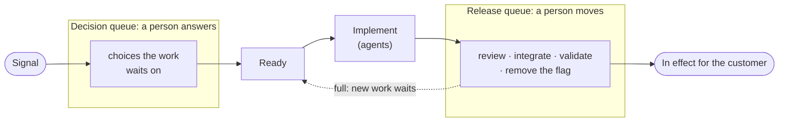

# Delivery Process

How work in a software project goes from a signal to a closed task, once, for every project. A task's state lives in Flow; each tick reads it, applies the [transitions](#transitions) that came due and writes the result. This is the engine; each project extends it with its answers to the [parameters](parameters.md), and a project with no answer gets the default. The process is [Get Things Flowing](https://flow.ttoss.dev/docs/agents/protocol.md) (GTF) applied to product development: the rule ids below are GTF's.

## Three rules

The rules of any work are GTF's, cited below by id. Three are the delivery process's own:

1. **One owner per transition.** Only a stage's owner changes the task's state in that stage. Two owners drift apart silently, each acting on a state the other already changed.
2. **Rounds have a limit.** Each reason a change goes back (red checks, findings) gets the automatic rounds the `Merge rule` allows; the next goes to a person, and so do findings the `Merge rule` gives to a person, with no round ([The author never verifies its own work](./principles.md#the-author-never-verifies-its-own-work)).
3. **What ages fastest goes first.** Work is ordered by its cost of delay, read from the stage the work is in and the one word a person may say about it, never estimated per task ([Cost of delay orders the work](./principles.md#cost-of-delay-orders-the-work-read-from-a-proxy-nobody-estimates)). The tick works, in order:

   1. a repo whose default branch is red: its repair, since it holds every change in the repo;
   2. a task at `very_high` priority, bug or not, in any stage, asserted or inherited from an open commitment it blocks (Flow's `inherited_priority`);
   3. a bug (a task tagged `bug`) at `high`, asserted or inherited;
   4. what integrated and nobody has seen in effect;
   5. the waits that came due;
   6. what is open at its gates (a conflict, a fix round or a review the agents run), among which only Flow's ranking orders;
   7. new work.

   Every other priority a person set orders the work inside a stage, never across stages.

## Words

The process names acts, not tools, so it reads the same on any code host and for deliveries that are not code:

| Word | What it is | Examples |
| --- | --- | --- |
| change | what alters the product or its world | a pull request (the default), a merge request, a commit, a post, a CMS entry, a flag, a migration |
| gate | a check a change must pass | CI, an agent's review, a person's review, an approval, a store's review |
| integrate | the act that makes a change official | merge, publish, apply, execute |
| release | what puts an integrated change in effect | deploy, publish a package and bump its consumer, roll out |
| verify | observe the effect where it matters | a production query, a registry install, a device, a dataset |

## The stages

| # | Stage | Owner | Starts when | Writes to Flow before it ends | Parameter |
| --- | --- | --- | --- | --- | --- |
| 1 | Intake | whoever finds the signal: an intake [routine](routines.md#project-routines), a person, an agent mid-task | an alert, feedback, an idea, a finding | a task with its `source` and what was investigated, `active`, or, when found mid-task, `active` when it leaves the product unchanged, else `incubated`, or what the standing decision names (GTF-C1); never a fix | `Intake` |
| 2 | Decide | a person | a choice the work needs, or a brief short of the `Ready brief` | the answer, on the task that waits on them (the move that frees it cites their words), or as the `outcome` of a `decision` that holds several tasks | `Decisions`, `Ready brief` |
| 3 | Implement | a child run, or a person | the task is ready, or a round sends it back | the change, which improves the code it touches and widens no further, proposed ready (not draft); an `implements` reference; `after_integration`, what integrating leaves (close, a release step, or a check with what to observe, where and when it can be seen), following the [closing validation](./parameters.md#closing-validations) the brief names; in the change's description, the task's URL, the tasks it settles, and the assumptions made and the choices answered on the way, each with what was checked (`Decisions`); the task `waiting` on the gates | `Before proposing` |
| 4 | Gates | automation, the reviewer `Review` names (a review child of the tick, a project routine or a person), the person the `Merge rule` reserves | the change is proposed | nothing on the task: verdicts stay on the change, each bound to the commit it judged (the `flow/review` status), and the tick writes after them | `Review`, `Merge rule` |
| 5 | Integrate | whoever the `Merge rule` lets integrate: the reviewer, the tick or a person | the gates pass | nothing on the task: the tick writes what integrating leaves | `Merge rule` |
| 6 | Release | the `Release procedure`: automation, a child run or a person | integration | a release step that is somebody's act is its own task that `blocks` the integrated task (GTF-N4); a pipeline every integration runs is a wait, not a task | `Release procedure` |
| 7 | Verify | the reader the `Closing evidence` names, else a check child of the tick | the check comes due | `completed` with what was observed, or `active` again with it (GTF-E8), the change reverted first when what was observed is harm | `Closing evidence` |

A stage a project, or a [delivery kind](#delivery-kinds), answers with "none" is skipped: with no review, the gates are the checks; with no release, integrated is in effect once its pipeline passes. A gate may also run after integrating, as in trunk-based work: its failure is the "pipeline red after integrating" transition below.

## Where work waits

The work that waits in this process waits on a person, in one of two queues on either side of Implement. Everything else the agents drain on their own. Why each is named, counted and held by its own rule is in [Principles](./principles.md#the-release-queue-holds-new-work-upstream).

The **release queue** is every change between its implementation and its release to the customer in production, the stages from Gates to Verify: a change open past draft, at its gates or with a person to integrate it, and an integrated change whose task waits on a person to see it in effect, such as a validation or a feature flag's removal, or whose check came due. A validation the person scheduled for a later date, each of their waits `scheduled` and still in the future, is held by that decision, like `incubated` work, and enters the queue on its date; an `external` wait on a person has a date that is only when to chase it, so it counts from the integration; a wait on nobody is outside the team, and holding new work would not drain it, so it never counts. Its limit is the [`Release queue`](./parameters.md#runtime) parameter. Once the queue reaches it, the tick starts no new work that a person would have to move, and spends its runs on what drains the queue, by [rule 3](#three-rules). A task whose path to production reaches no person still starts, as many at once as the [`Person-free lane`](./parameters.md#runtime) parameter allows: its closing validation closes it at integration, the `Merge rule` lets the agents integrate what it touches, it needs no flag, manual step or release a person takes part in, and its brief leaves no choice open. It holds the lane from its start until it closes, and one that lands on a person after all counts in the queue like any change. What the Chase and the Health do with a full queue is in [Routines](routines.md#standard-routines).

The **decision queue** is every open choice that holds work before it can start, the Decide stage: a `decision` that `blocks` the tasks it holds, or a task waiting on a person for an answer its brief needs. Most choices never enter it, because the [`Decisions` default](./parameters.md#the-decisions-default) and the project's standing decision answer them by rule. A decision holds only the work it blocks, so it never counts against the release queue ([A choice is answered by a rule where one exists](./principles.md#a-choice-is-answered-by-a-rule-where-one-exists-and-by-a-person-when-the-work-needs-it)).

## Who writes the task

- **After the verdict, the tick is the only writer of the task's status and wait** (GTF-S3). It writes every transition whose owner does not write to Flow, such as CI, the code host, or a person who merged or reviewed, and every one an owner left unwritten. A run that only contributed to a stage, such as a reviewer, leaves its verdict on the change and writes at most references for what it produced.
- With no tick, because nothing schedules one, the next run that reads the graph writes what the tick would.

## States

| Where the task is | Status | What holds it | Who acts next |
| --- | --- | --- | --- |
| Ready | `active` | nothing | the tick delegates it, or a person takes it |
| A choice for a person | `waiting`, or `active` behind a `decision` | an `external` wait `on` the person, or the decision's `blocks` edge | the person |
| At the gates | `waiting` | `external`: the gates the change waits on | the gates; the tick reads the verdict |
| A round back | `active` | nothing; the body carries the log or the findings | the tick delegates a fresh child |
| Reserved for a person | `waiting` | `external` `on` the person, naming what is ready for them | the person |
| Waiting for a release | `active` | the release task's `blocks` edge (readiness `blocked:dependency`) | the release's owner |
| Waiting for the check | `calendar` | `scheduled`: the check and its date | the check's reader |
| Done | `completed` | nothing | nobody |

## Transitions

The tick applies these on every tick, under the standing decision:

| When | The tick |
| --- | --- |
| The change's checks pass with no verdict for its head, and `Review` gives the review to an agent | starts a review child, which leaves its verdict on the change, unless a reviewer claimed the head within `Stale after` |
| The change's checks pass with no verdict for its head, and `Review` names a reviewer outside the tick | waits: a missing verdict is never a passed gate |
| The gates pass (a verdict for the head, or `Review` none) and the `Merge rule` lets the agents integrate | integrates the change, when the code host requires that review; otherwise moves the task to `waiting` on a person, naming what is ready |
| Checks red, or findings, within the round limit | moves the task to `active` with the log or the findings in the body, for a fresh child on the same change |
| Findings the `Merge rule` gives to a person (a finding only a person can act on, or a change it reserves to a person) | moves the task to `waiting` on that person, naming the findings, with no round |
| The round limit reached (rounds are the task's fix runs; a red caused outside the change, such as a broken default branch or infrastructure, does not count) | moves the task to `waiting` on a person |
| A review request lost: no verdict and no claim `Stale after` after the checks passed, or a claim that outlived it with no run holding the task | applies the `Review` fallback |
| The change needs what the `Merge rule` reserves to a person | moves the task to `waiting` on that person, naming what is ready |
| A conflict with the default branch | moves the task to `active` for a fresh child that resolves it |
| A step only a person can do before integrating (a migration, a manual check) | writes that step as a task, theirs, that `blocks` the task (GTF-N4) |
| The change closed without integrating | retracts its `implements` reference and moves the task to `waiting` on a person: implement it again, or cancel it. A change of the task in the same repo that integrated or is still open superseded it: the tick only retracts the reference, and the task follows that change |
| The change integrated, nothing written since | applies the task's `after_integration`: closes it on immediate evidence, citing the change; or the release step; or the check's wait. A task with several changes waits for the last one |
| A task nobody holds (no person, run or `blocks` edge) is `active`, written after its change integrated | reads why from its history ([The graph is the state](./principles.md#the-graph-is-the-state-and-a-tick-is-a-function-of-it)): sent back by a failed check, a revert or a person asking for rework → a round on a fresh change; a person cleared its check's date early → starts the check child; its last write only handed it off, citing a change that had already integrated → applies its `after_integration` |
| The check's wait is applied | dates it by the check's `visible_at`, or now when that date has passed (GTF-E8) |
| The task waits on a person because nothing said what integrating leaves, and its `after_integration` is now written | applies it as above: that write is the person's answer, never a sign the tick already acted |
| The task carries an `after_integration` and a different wait on a person, such as a check child's for an act only they can do | leaves the wait: it is not answered by an `after_integration` the task already carried |
| The task carries no `after_integration` and its brief names a closing validation | applies that validation's level as above: the brief already said what integrating leaves |
| The `Closing evidence` gives the agent the choice of what integrating leaves | chooses the level itself from the change and the task, with its reason, instead of the wait; a wait it wrote before the parameter said so is read again on the next tick |
| The integration's pipeline red | reverts the change by the reversal path its description records (`Before proposing`), then moves the task to `active` with the log and the revert, a round: a defect in effect costs by the hour, a round costs a child and its checks |
| The integration's pipeline red, and the change records no reversal path | moves the task to `waiting` on a person, naming the red |
| A repo's default branch red | opens the repair task, which `blocks` each task the red branch holds, so its leverage is what puts it first; the red is the repair task's, never a round on the changes it holds |
| The change's description names other tasks it settles | closes them on integration, citing the change, as far as the standing decision delegates tidying (GTF-S6) |
| A change in the project's repos names no task | applies the `Intake` answer: writes a task for it, or leaves it |
| A release step's task closes | moves each integrated task it held to its check's wait, or closes it citing the release task, whose outcome is the evidence: once the edge stops holding it, the task is `active` and ready, and only this transition keeps it from reading as new work |
| A task is held only by `blocks` sources whose change integrated and that stay open (a release or a check later) | reports it, and the Chase lists it for a person, who retracts the edge to start it now or keeps it until the sources close; the edge keeps gating until then. It retracts the edge itself, recording a `mentions` with the change, only when the standing decision delegates that ([Autonomy is bounded by reversibility](./principles.md#autonomy-is-bounded-by-reversibility)) |
| A check comes due | starts a check child (unless the `Closing evidence` names another reader), which closes the task with what it observed or sends it back; harm the change caused is reverted first, as in the "pipeline red" row |
| A child's run failed, is gone, or stays `running` past the `Runtime`'s `Stale after` with its task open | closes the run `failed`; the task is ready again |
| A run starts | records `Stale after` as its hold, so Flow keeps its tasks from other runs exactly that long |
| Another agent's run, such as a person's session, holds an open task past `Stale after` | leaves it to the run's owner |

A person reviewing a change has three outcomes: integrate it, ask for changes (the task goes back a round), or close it, which is the "closed without integrating" row.

## Delivery kinds

A pull request through the code host is the default kind. A project that also delivers in other ways (content, a CMS entry, a feature flag, manual infrastructure, a data fix) names each kind in `Delivery kinds`: its gates (a person's approval when the act reaches outside the product), who integrates it (executes it), and what proves it. Each kind runs the same stages; most just answer "none" to more of them.

## Prerequisites

- **The code host enforces the `Merge rule`.** Required checks, branch protection and required reviews make the rule true for everyone, not only for the agents. With a reviewer in `Review`, its verdict is the `flow/review` commit status on the head and a required check, so a verdict is bound to its commit and only an identity with write access can give it; without that, the tick integrates nothing and waits on a person.
- **What judges or instructs the agents changes only through a merge a person approved**: the CI configuration and required checks through code owners or the host's equivalent, and the agent instructions the same way, so the standing decision can point at the instructions (GTF-A6).
- **The runtime allows every act the standing decision delegates.** An act the runtime refuses, such as a merge or a release step its permission rules block, moves the task to `waiting` on a person, naming the refusal (GTF-U3).
- **Something fires the runs.** Flow keeps the state but wakes nobody (GTF-S5): the project's [routines](routines.md) start each run fresh from the graph.
