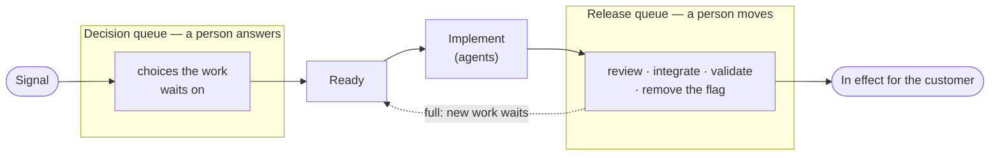

# Two Queues

Agents implement faster than people answer, so the work that waits in this workflow waits on a person, in one of two queues on either side of the implementation. The **decision queue** holds the choices work waits on before it can start; the **release queue** holds the work agents implemented that waits to reach the customer in production. Everything else the agents drain on their own. Why the workflow names, counts and limits these two, each by its own rule, is in [Principles](./principles.md#a-persons-attention-is-the-critical-queue).

## Release queue

Every change between its implementation and its release to the customer in production: a change open past draft, at its gates or with a person to integrate it, and an integrated change whose task waits on a person to see it in effect, such as a validation or a feature flag's removal. It covers the [stages](./process.md#the-stages) from Gates to Verify, and it ends at the release because only then does the work earn anything or tell anyone whether it was right ([The release queue holds new work upstream](./principles.md#the-release-queue-holds-new-work-upstream)).

Its limit is the project's [`Release queue`](./parameters.md#runtime) parameter. Once the queue reaches it, the tick starts no new work and spends its runs on what drains the queue: integrating, releases, checks, fix rounds, a `very_high` task and a `high` bug. The Chase lists, each day, the items in it that only a person can move, in the order the tick works and as many as the limit; an item an agent can move never reaches the list.

## Decision queue

Every open choice that holds work before it can start: a `decision` that `blocks` the tasks it holds, or a task waiting on a person for an answer its brief needs. It is the [Decide stage](./process.md#the-stages). Most choices never enter it, because the [`Decisions` default](./parameters.md#the-decisions-default) and the project's standing decision answer them by rule; what reaches it is what a rule cannot settle and what is a person's by reservation ([A choice is answered by a rule where one exists](./principles.md#a-choice-is-answered-by-a-rule-where-one-exists-and-by-a-person-when-the-work-needs-it)).

A decision holds only the work it blocks, so it never counts against the release queue. Its moment is when the work it frees could start, so the Chase lists the decisions the team owes only while the release queue is within its limit, as many as that limit; over the limit, the tick would not start that work, and the person's attention belongs to the release queue.

## Reading both

|                 | Decision queue                                      | Release queue                                       |
| --------------- | --------------------------------------------------- | --------------------------------------------------- |
| Holds           | choices work waits on before it starts              | implemented work not yet in effect for the customer |
| Stages          | Decide                                              | Gates, Integrate, Release, Verify                   |
| Kept small by   | decision rules that answer before a person is asked | the limit that holds new work upstream              |
| The Chase lists | only while the release queue is within its limit    | always, what only a person can move                 |

Each day's Chase is the short list of both. Every week the [Audit](./routines.md#standard-routines) shows the flow's health, each person's arrivals against departures in the states only their answer frees, and a person's queue that grew two weeks running opens its report.
