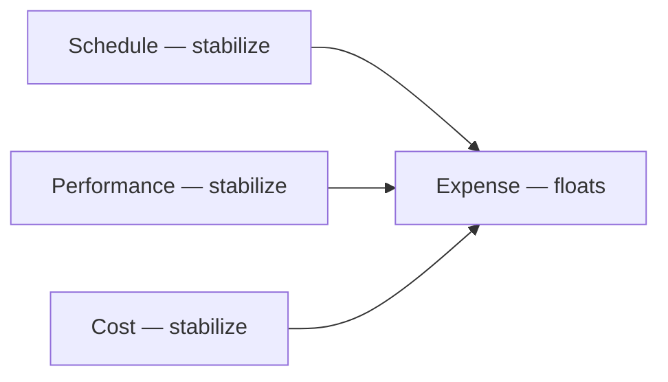

## V1: The Principle of Beneficial Variability: Variability can create economic value.

Which choice is the best economic choice? Which option has the minimum uncertainty in its outcome?

| Choice | Stakes   | Payoff    | Probability | EMV     |
| ------ | -------- | --------- | ----------- | ------- |
| A      | \$15,000 | \$100,000 | 50%         | $35,000 |
| B      | \$15,000 | \$20,000  | 90%         | $3,000  |
| C      | \$15,000 | \$16,000  | 100%        | $1,000  |

_EMV = Expected Monetary Value_

Choice A is the best economic choice and the most uncertain. Choice C has zero uncertainty, yet it isn't the best economic choice.

The economics of each discrete choice depends on two factors: the probability and the payoff function. We can't make good economic choices if we only pay attention to probabilities. So you need to pay attention to both probability and payoff functions.

## V2: The Principle of Asymmetric Payoffs: Payoff asymmetries enable variability to create economic value.

## V3: The Principle of Optimum Variability: Variability should neither be minimized nor maximized.

## V4: The Principle of Optimum Failure Rate: Fifty percent failure rate is usually optimum for generating information.

## V5: The Principle of Variability Pooling: Overall variation decreases when uncorrelated random tasks are combined.

## V6: The Principle of Short-Term Forecasting: Forecasting becomes exponentially easier at short time-horizons.

## V7: The Principle of Small Experiments: Many small experiments produce less variation than one big one.

This principle emphasizes that breaking a large risk into many smaller, independent risks reduces the overall variation in outcomes. This idea stems from statistics, where repeated small trials (a binomial distribution) result in a smaller coefficient of variation compared to a single large trial. This is because, as the number of trials increases, the mean grows faster than the standard deviation, lowering the overall risk of failure.

For example, dividing a single high-risk bet (e.g., a 50% chance of losing $15,000) into multiple smaller bets significantly decreases the chance of total loss. Similarly, in product development, launching several smaller innovations rather than one blockbuster product reduces the risk of complete failure, offering more consistent and stable outcomes.

## V8: The Repetition Principle: Repetition reduces variation.

## V9: The Reuse Principle: Reuse reduces variability.

## V10: The Principle of Negative Covariance: We can reduce variance by applying a counterbalancing effect.

## V11: The Buffer Principle: Buffers trade money for variability reduction.

## V12: The Principle of Variability Consequence: Reducing consequences is usually the best way to reduce the cost of variability.

Reducing how often something goes wrong changes the probability function; reducing what it costs when it does changes the payoff function, and the payoff function has two sides to work on. On the left, cut the loss by truncating a bad path quickly: a feature far harder to build than expected is dropped. On the right, raise the gain by extending a good one: a feature easier than expected is overachieved.

Manufacturing rarely sees this, because its payoff is symmetric: any deviation from the target costs, so reducing variability is the only sensible move. Product development's payoff is asymmetric: the left side is bad variability and the right side good ([V2](/docs/product/product-development/principles/exploiting-variability#v2-the-principle-of-asymmetric-payoffs-payoff-asymmetries-enable-variability-to-create-economic-value)), so cutting the consequence of the left side beats cutting variability itself. Lean manufacturing hides the idea in _jidoka_: Toyota's looms stopped when a thread broke, and any worker may stop the line, so a defect stops making defective work instead of only becoming rarer.

Fast feedback attacks both functions at once. A programmer who makes a bad assumption about a protocol and sees the test results in a day instead of a month stops making it, which lowers the frequency, and has written little code on top of it, which lowers the consequence. Together the two effects can cut the cost of variability by an order of magnitude.

## V13: The Nonlinearity Principle: Operate in the linear range of system performance.

Most systems respond in proportion to a deviation within a range and degrade sharply outside it. A sailboat that heels is pushed back upright, until it heels past the angle where the righting force reverses and it capsizes; in heavy wind, sailors trim and reduce sail to stay well away from that angle. Delay behaves the same way: a short slip can be recovered with extra sales and marketing effort, while a long one does geometrically more damage.

So operate where the system is linear, and guard against the extreme left-side events with circuit breakers that stop spending time and money once the work enters the nonlinear zone ([F1](/docs/product/product-development/principles/controlling-flow-under-uncertainty#f1-the-principle-of-congestion-collapse-when-loading-becomes-too-high-we-will-see-a-sudden-and-catastrophic-drop-in-output)).

## V14: The Principle of Variability Substitution: Substitute cheap variability for expensive variability.

Variability can be pushed from an expensive measure of performance into a cheap one. Missing a schedule may be expensive while a low manufacturing yield in the first weeks of production is cheap, so accept the yield variation to hold the cycle time. Paying expedite charges so a late part does not delay the project does the same: overspending the expense budget costs less than missing the date.

Letting one measure float to hold the others steady is only sound when the economic cost of variability in each is known, which is what the [cost of delay](/docs/product/product-development/principles/economic-view#e3-the-principle-of-quantified-cost-of-delay-if-you-only-quantify-one-thing-quantify-the-cost-of-delay) gives.

## V15: The Principle of Iteration Speed: It is usually better to improve iteration speed than defect rate.

Over a series of iterations, the defects that survive are the per-iteration defect rate raised to the number of iterations. There are two ways to reduce them: lower the rate per iteration, the base, or run more iterations in the same time, the exponent. When the two cost about the same, the exponent wins. Halving a 2% defect rate to 1% leaves 1% after one iteration; halving a two-week cycle to one week gives two iterations at 2%, which leaves 0.04%, 25 times better.

Iteration speed is also usually the cheaper of the two to improve, because iteration time is mostly [queue time](/docs/product/product-development/principles/managing-queues), so reducing queues pays here too.

## V16: The Principle of Variability Displacement: Move variability to the process stage where its cost is lowest.

Just as variability can be moved between measures of performance ([V14](#v14-the-principle-of-variability-substitution-substitute-cheap-variability-for-expensive-variability)), it can be moved between stages of a process: put it where it costs least. An airport's landing rate varies, so a few planes hold in the air to keep the runway busy; but circling is expensive, so controllers slow planes en route and hold most of them on the ground before takeoff, the cheapest place in the system. The landing's variation becomes variation in departure time.

A new project starts accruing perishable cost the moment it enters the pipeline: market research done for a product that crawls for two years is two years stale when the product ships. It is cheaper to hold the project in a ready queue upstream and start it when it can flow. The exception is a small early investment that buys information which changes the odds of what follows, such as an early patent search ([E18](/docs/product/product-development/principles/economic-view#e18-the-principle-of-buying-information-the-value-of-information-is-its-expected-economic-value)). Restricting how many bugs are worked at once, rather than starting them all, applies the same rule ([W21](/docs/product/product-development/principles/applying-wip-constraints#w21-the-principle-of-the-critical-queue-constrain-wip-in-the-section-of-the-system-where-the-queue-is-most-expensive)).
