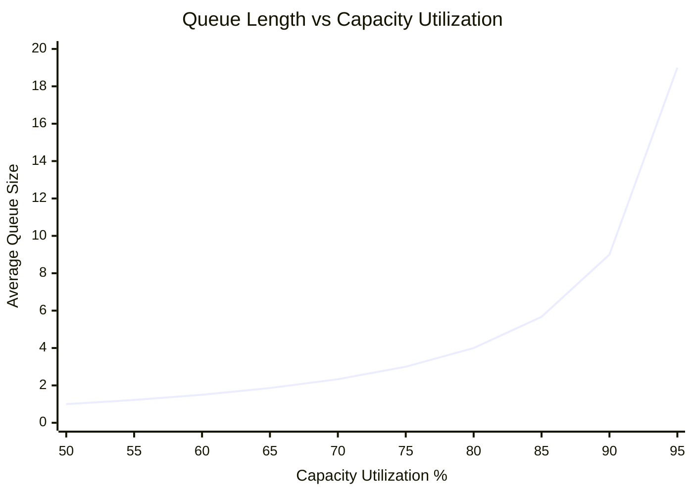

**[Q1](#q1-the-principle-of-invisible-inventory-product-development-inventory-is-physically-and-financially-invisible) to [Q2](#q2-the-principle-of-queueing-waste-queues-are-the-root-cause-of-the-majority-of-economic-waste-in-product-development) - Why Queues Matter?** Queues matter because they're economically important, poorly managed, and they have the potential to be much better managed. They profoundly affect the economics of product development.

**[Q3](#q3-the-principle-of-queueing-capacity-utilization-capacity-utilization-increases-queues-exponentially) to [Q8](#q8-the-principle-of-linked-queues-adjacent-queues-see-arrival-or-service-variability-depending-on-loading) - The Behavior of Queues.** To understand the behavior of queues, you need to understand how capacity utilization and variability affect the size of queues, the relative frequency of high-queue states, and how the structure of a queueing system affects their performance.

**[Q9](#q9-the-principle-of-queue-size-optimization-optimum-queue-size-is-an-economic-trade-off) to [Q10](#q10-the-principle-of-queueing-discipline-queue-cost-is-affected-by-the-sequence-in-which-we-handle-the-jobs-in-the-queue) - The Economics of Queues.** Optimizing queues brings a problem because the higher you utilize capacity, the more you pay for queues, but the less you pay for excess capacity. How to make quantitative trade-offs between them? How can you use queueing discipline to reduce the economic cost without reducing the queue size?

**[Q11](#q11-the-cumulative-flow-principle-use-cfds-to-monitor-queues) to [Q16](#q16-the-intervention-principle-we-cannot-rely-on-randomness-to-correct-a-random-queue) - Managing Queues.** Six principles to help you manage queues. First is the cumulative flow diagram (CFD). Second, the Little's Formula. Then, two important principles for controlling queue size. Finally, the counterintuitive nature of random processes.

## Q1: The Principle of Invisible Inventory: Product development inventory is physically and financially invisible.

Inventory in product development isn't physical objects but information. Then, it's virtually invisible, both physically and financially. Product development inventory's effects: increased [cycle time](/docs/product/product-development/definitions#cycle-time), delayed feedback, constantly shifting priorities, and status reporting.

## Q2: The Principle of Queueing Waste: Queues are the root cause of the majority of economic waste in product development.

## Q3: The Principle of Queueing Capacity Utilization: Capacity utilization increases queues exponentially.

As teams approach 100% capacity utilization, queue lengths grow exponentially, not linearly. This creates a dramatic impact on cycle times and team velocity.

For an M/M/1 queue system, where ρ (rho) represents capacity utilization as a decimal (0.75 = 75% utilization):

**Core Queueing Formulas**:

- $\text{Percent Capacity Utilization} = \rho$
- $\text{Percent Unblocked Time} = 1 - \rho$
- $\text{Number of Items in Queue} = \cfrac{\rho^2}{1-\rho}$
- $\text{Numbers of Items in System} = \cfrac{\rho}{1-\rho}$
- $\text{Percent Queue Time} = \rho$
- $\cfrac{\text{Cycle Time}}{\text{Value-Added Time}} = \cfrac{1}{1-\rho}$

Here's how capacity utilization affects average queue size:

| Capacity Utilization | Average Queue Size | Relative Delay | Cycle Time Multiplier |
| -------------------- | ------------------ | -------------- | --------------------- |
| 50%                  | 1.0                | 1x             | 2x                    |
| 60%                  | 1.5                | 1.5x           | 2.5x                  |
| 70%                  | 2.3                | 2.3x           | 3.3x                  |
| 80%                  | 4.0                | 4x             | 5x                    |
| 90%                  | 9.0                | 9x             | 10x                   |
| 95%                  | 19.0               | 19x            | 20x                   |

Note that as you halve the amount of excess capacity, you roughly double the average queue size. From 70% to 80%, you double the queue size. From 80% to 90%, you double it again. From 90% to 95%, you double it once more.

In practice, it's hard to measure capacity utilization directly. As you shall see in this principles, you find more practical ways to estimate it, like queue size and WIP (work in process).

## Q4: The Principle of High-Queues States: Most of the damage done by a queue is caused by high-queues states.

Queues spend more time in low-queue states, but high-queue states cause the most harm. When a queue is overloaded, it delays more tasks, increases cycle times, and leads to greater economic waste. Even though high-queue states are less frequent, they have a much bigger impact on overall performance and efficiency.

The State Probability of an $M/M/1/\infty$ queue to have $n$ jobs in the system is:

$$
\text{State Probability} = \frac{1-\rho}{\rho^n}
$$

For example, for a queue with at 75% utilization, the probabilities of having $n$ jobs in the system are:

| Number of Jobs in the System | Probability |
| ---------------------------- | ----------- |
| 0                            | 25%         |
| 1                            | 18.8%       |
| 2                            | 14.1%       |
| 3                            | 10.5%       |

This means that the probability of having two jobs are 75% of the probability of having one job in the system. However, delaying two units creates twice the economic waste (see [The Hidden Costs of Queues in Product Development](/blog/2024/09/24/the-hidden-costs-of-queues-in-product-development) for more details) of delaying one unit.

## Q5: The Principle of Queueing Variability: Variability increases queues linearly.

## Q6: The Principle of Variability Amplification: Operating at high levels of capacity utilization increases variability.

## Q7: The Principle of Queueing Structure: Serve pooled demand with reliable high-capacity servers.

## Q8: The Principle of Linked Queues: Adjacent queues see arrival or service variability depending on loading.

In systems where one queue feeds into another, the output of one queue becomes the input for the next. The way each queue performs depends on how busy it is—its output may either mirror the rate at which tasks arrive or the speed at which they are completed.

In a process with several linked queues, one queue usually slows down the entire system (the bottleneck). To improve the flow and speed up the whole process, it's important to reduce delays and unpredictability at the bottleneck by managing how tasks arrive from the previous queue. By controlling what happens before the bottleneck, you can improve the flow through it and make the system more efficient.

## Q9. The Principle of Queue Size Optimization: Optimum queue size is an economic trade-off.

## Q10. The Principle of Queueing Discipline: Queue cost is affected by the sequence in which we handle the jobs in the queue.

## Q11: The Cumulative Flow Principle: Use CFDs to monitor queues.

The cumulative flow diagram (CFD) is one of the most useful tools for managing queues. It plots time on the horizontal axis and two cumulative counts on the vertical one: work that has arrived at a process and work that has left it.

The vertical distance between the two lines is the work that has arrived but not left, the size of the queue at that moment. The horizontal distance is the time one item takes to get through, and the area between the lines is the queue over time. The arrival line's slope is the demand feeding the queue; the departure line's slope is the capacity draining it, so a change in either slope shows a trend in demand or capacity. Batches show up as jagged lines ([Reducing Batch Size](/docs/product/product-development/principles/reducing-batch-size)).

Tracking queue size over time is a good start, but it only shows the balance between arrivals and departures. A CFD shows which side caused a growing queue, excess arrivals or too few departures, so it detects an emerging queue, sizes it, and tells what to do about it and when it will clear.

## Q12: Little's Formula: Wait Time = Queue Size/Processing Rate

Average time in queue equals average queue size divided by average processing rate, a result John D. C. Little proved in 1961 that holds for virtually any queueing discipline, arrival process or departure process. It is like draining a tank: 10 liters at 1 liter a minute takes 10 minutes.

The formula applies to a single queue or to the whole system. The system level is especially useful when it is hard to tell which work is waiting and which is being worked on, and it defeats the claim that "we are working on everything": count all design-in-process, divide by the completion rate, and the cycle time follows. A development process with 50 projects in progress that finishes 10 a year takes 5 years per project; a test area with 50 tests in progress that finishes 10 a week takes 5 weeks per test. Doing this per stage gives each stage's cycle time, the overall cycle time and the delay cost of each stage.

Count only the critical path when totalling cycle time, since queue time off it adds no delay to the project. That does not make such queues free: a task's cost of delay is the project's times the probability the task ends up on the critical path, and every queue also delays feedback, adds overhead, lowers quality and raises variability.

Queue time can be found two ways. Give one job preemption everywhere, a "hot lot" that never waits; its cycle time is pure service time, and the difference from the average cycle time is queue time. Or divide a process's applied hours by its throughput: 40 hours a week over 10 jobs is 4 hours of service per job, so a 40-hour average cycle time is 10% value-added time and 90% queue time.

## Q13: The First Queue Size Control Principle: Don't control capacity utilization, control queue size.

Controlling cycle time through capacity utilization is impractical in product development, because neither demand nor capacity can be estimated accurately enough ([Q3](/docs/product/product-development/principles/managing-queues#q3-the-principle-of-queueing-capacity-utilization-capacity-utilization-increases-queues-exponentially)). Utilization is almost useless for real-time control.

Queue size works instead, thanks to the steep queueing curve: a small change in utilization causes a large change in queue size and cycle time, so a fairly wide control band on queue size holds utilization in a tight range, and controlling queue size directly controls cycle time. Supermarkets do this: when more than three customers wait at a checkout, a cross-trained employee opens another, and closes it once the lines clear ([Applying WIP Constraints](/docs/product/product-development/principles/applying-wip-constraints)).

## Q14: The Second Queue Size Control Principle: Don't control cycle time, control queue size.

Cycle time is a lagging indicator: it cannot be measured until a job leaves the system. Queue size reacts at once. If 400 passengers join a queue of 100 at an immigration area at time 21, the queue has more than doubled by time 22, but the first passenger to report a doubled cycle time leaves only at time 41. Watching the queue reveals the problem 20 times sooner than watching cycle time ([FF3](/docs/product/product-development/principles/using-fast-feedback#ff3-the-principle-of-leading-indicators-select-control-variables-that-predict-future-system-behavior)).

## Q15: The Diffusion Principle: Over time, queues will randomly spin seriously out of control and will remain in this state for long periods.

## Q16: The Intervention Principle: We cannot rely on randomness to correct a random queue.

When a queue builds up into a sustained high-load state, it won't easily or quickly revert to a low-load state on its own. Just like flipping 10 heads in a row doesn't increase the chance of flipping 10 tails to balance it out, randomness won't fix the problem.

You need to intervene quickly and decisively in such situations. Set limits on maximum queue size, and act before the system hits those limits. The more closely you monitor queues and intervene early, the less they will cost you in the long run.
